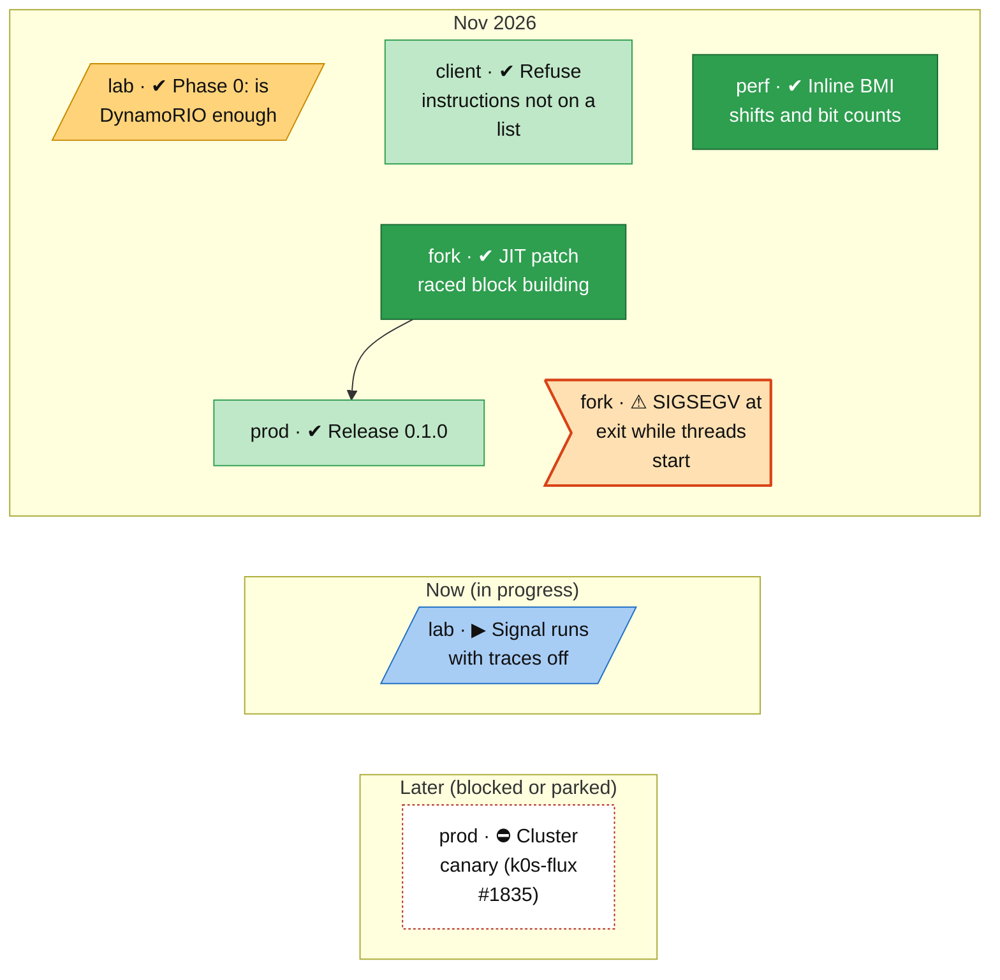

# Roadmap

Everything between the GENERATED markers is rebuilt from `roadmap/nodes.yaml`; edit that file, not the regions. Text outside the markers is kept.

## Legend

```mermaid
flowchart TB
    %% legend
    subgraph lg_g0["Done: colour is the rating"]
        direction LR
        lg_s0["✔ very successful"]
        lg_s1["✔ successful, or fixed"]
        lg_s2["✔ mixed"]
        lg_s3["✔ bad (regression)"]
        lg_s4["✔ done, not rated"]
    end
    subgraph lg_g1["Closed"]
        direction LR
        lg_s5["✖ dead end"]
        lg_s6["↷ superseded"]
    end
    subgraph lg_g2["Open: colour is the state"]
        direction LR
        lg_s7["▶ in progress"]
        lg_s8["⏳ built, waiting"]
        lg_s9["○ next"]
        lg_s10["⛔ blocked"]
        lg_s11["⏸ parked"]
        lg_s12>"⚠ open, never rated"]
    end
    subgraph lg_shape["Shape: kind"]
        direction LR
        lg_k0["○ feature"]
        lg_k1["○ fix"]
        lg_k2[/"○ experiment"/]
        lg_k3("○ design")
        lg_k4["○ tooling"]
        lg_k5>"⚠ defect"]
        lg_k6{{"○ decision (open, not<br/>drawn)"}}
        lg_k7{{"✔ decision (decided)"}}
    end
    subgraph lg_edge["Arrow (in the trees every arrow points down, forward in time)"]
        direction LR
        lg_e0a["prerequisite"]
        lg_e0b["depends on it"]
        lg_e1a["old design"]
        lg_e1b["replaced by"]
        lg_e2a["rated node"]
        lg_e2b["qualified by a later finding"]
    end
    lg_g0 ~~~ lg_g1 ~~~ lg_g2 ~~~ lg_shape ~~~ lg_edge
    lg_e0a --> lg_e0b
    lg_e1a -.-> lg_e1b
    lg_e2a -.-> lg_e2b
    linkStyle 6 stroke:#e69500,stroke-width:3px,stroke-dasharray:2 3
    classDef vsucc fill:#2e9e4f,stroke:#1b6b34,color:#fff
    classDef succ fill:#bfe8c8,stroke:#2e9e4f,color:#111
    classDef mixed fill:#ffd37a,stroke:#c98a00,color:#111
    classDef bad fill:#f28b82,stroke:#b3261e,color:#111
    classDef dead fill:#e6e6e6,stroke:#777,stroke-dasharray:5 5,color:#555
    classDef inprog fill:#a8cdf5,stroke:#1f6fc5,color:#111
    classDef next fill:#fff,stroke:#333,color:#111
    classDef blocked fill:#fff,stroke:#b3261e,stroke-dasharray:2 2,color:#111
    classDef parked fill:#f3f3f3,stroke:#999,color:#555
    classDef unrated fill:#fff,stroke:#333,stroke-dasharray:1 3,color:#111
    classDef gate fill:#d9c2f0,stroke:#7b3fb5,color:#111
    classDef decided fill:#ece0f7,stroke:#7b3fb5,stroke-dasharray:2 2,color:#111
    classDef finding fill:#ffe0b2,stroke:#d84315,stroke-width:2px,color:#111
    classDef waiting fill:#e3f2fd,stroke:#1f6fc5,stroke-dasharray:5 5,color:#111
    class lg_s0 vsucc
    class lg_s1 succ
    class lg_s2 mixed
    class lg_s3 bad
    class lg_s4 unrated
    class lg_s5,lg_s6 dead
    class lg_s7 inprog
    class lg_s8 waiting
    class lg_s9,lg_k0,lg_k1,lg_k2,lg_k3,lg_k4,lg_e0a,lg_e0b,lg_e1a,lg_e1b,lg_e2a,lg_e2b next
    class lg_s10 blocked
    class lg_s11 parked
    class lg_s12,lg_k5 finding
    class lg_k6 gate
    class lg_k7 decided
```

<!-- BEGIN GENERATED: legend -->

Owner calls are the purple shape. A decided owner call is drawn in the overview only, never in the track trees; an open one is listed under *Waiting on the owner*. The prefix on an overview box is its track. A prerequisite implied by a longer chain is not drawn; the node tables keep every edge.
<!-- END GENERATED: legend -->

## Ratings

<!-- BEGIN GENERATED: ratings -->
0 of 66 rated nodes are confirmed by the owner.

Not yet confirmed: `emu-preload`, `emu-gathers`, `emu-intel-nan`, `emu-mxcsr`, `client-forms`, `client-allowlist`, `client-seg-operands`, `client-block-end`, `client-seq-rwx`, `client-store-xl8`, `client-safe-translate-flushed`, `fork-signal-hang`, `fork-thread-private`, `fork-cache-reset`, `fork-ignore-syscalls`, `fork-vfork-signal`, `fork-signal-unlink`, `fork-map32bit`, `fork-torn-exit`, `fork-vfork-exit`, `fork-thread-create-fail`, `fork-kill-signal`, `fork-rebase`, `fork-vfork-exit-race`, `fork-trace-teardown`, `fork-ibl-race`, `fork-trace-emit`, `fork-sig-thread-start`, `fork-sigxcpu`, `fork-selfmod-xl8`, `fork-exit-sigmask`, `fork-safe-spot`, `fork-flushed-sandboxed`, `fork-vfork-kill`, `fork-close-range`, `fork-refuse-untranslatable`, `fork-selfwrite-flush`, `fork-heap-race`, `fork-selfmod-race`, `launch-static`, `launch-refused-exec`, `cache-phase2`, `cache-debug-fix`, `perf-startup-options`, `perf-memo-classify`, `perf-persist`, `perf-speed-inline`, `perf-inline-scalar`, `perf-inline-vec`, `perf-inline-xmm`, `perf-lean-call`, `perf-gencode-prot`, `perf-procmap`, `perf-protect-mask`, `perf-fma-scalar`, `perf-fma-packed`, `runtime-sde`, `runtime-v3compat-run`, `prod-release`, `lab-phase0`, `lab-ivy-ab`, `lab-ivy-gate`, `lab-ivy-traces`, `lab-thread-exit-test`, `client-kernel-module`, `perf-fast-decode`.
<!-- END GENERATED: ratings -->

## Overview

<!-- BEGIN GENERATED: overview -->

<!-- END GENERATED: overview -->

## In plain words

<!-- BEGIN GENERATED: plain-words -->
| title | status | in plain words |
|---|---|---|
| Retire leftover semantic test pieces | ○ next | The owner decides whether to keep test/misc_forms.c, retire avxemu's Intel reference file, and run the full imm8 semantic-hw as a nightly job. |
| Rewrite AVXEmu in Rust | ⏸ parked | A Rust rewrite of AVXEmu was set aside: the worst bugs were wrong instruction semantics, which a test suite catches and Rust does not. |
| Refuse instructions not on a list | ✔ done · successful | Every instruction shape the translator lets through is on an audited list built from runs on real CPUs; anything else stops the program with status 86 instead of guessing. |
| JIT patch raced block building | ✔ done · very-successful | A JIT patching a method while DynamoRIO copied it gave a block made of two different versions of the code (the status 255 crash); blocks are now built from one read. |
| SIGSEGV at exit while threads start | ⚠ open | When a process is already dying from a program fault, a thread starting at that moment can crash in DynamoRIO's init; the mechanism is confirmed, the fix is not done. |
| Keep SIGSEGV safe during exit | ○ next | The owner decides whether the fork should keep SIGSEGV handled while DynamoRIO runs the default action of a fatal signal. |
| One unreproduced regstress SIGSEGV | ⏸ parked | One signal-stress run crashed in CI on the rebased fork and was not seen again in 2,000 reruns. |
| Bare DynamoRIO hangs in control runs | ⏸ parked | DynamoRIO without our client, and with an empty client, hangs in about 12-15% of control runs; v3compat's client never did. |
| Signal behaviour differing from native | ⏸ parked | A lab with realistic signals found three differences from native that no fix tracks yet: a vfork child dies of a signal it should ignore, Java crashes under SIGTERM storms, and Python spawns crawl under frequent signals. |
| Canary with or without the cache | ○ next | The owner decides whether the cluster canary drops the cache (recommended) or keeps it, which needs more ADR 0006 work. |
| Inline BMI shifts and bit counts | ✔ done · very-successful | Six scalar BMI forms went from about 80 ns as a helper call to about 1 ns inline; Java's bit-twiddling round went from 7 s to 0.1 s. |
| Traces-off cost claim contradicted | ⚠ open | On Ivy Bridge, turning traces off used 27-33% less CPU on javac and java, against about 3% more on runners; README marks its claim contradicted. |
| Traces on or off by default | ○ next | The owner decides whether -disable_traces becomes the default, which also decides whether Phase 3's startup gate is met. |
| Release 0.1.0 | ✔ done · successful | The first release: a self-contained tarball whose output matched native byte for byte on Ivy Bridge, still about 20x slower than native at startup. |
| Cluster canary (k0s-flux #1835) | ⛔ blocked | A first real workload on the Ivy Bridge node through the wrapper; held unmerged until the owner decides about the cache. |
| Two weeks matching native | ⛔ blocked | Phase 4's go/no-go: two weeks of the canary with no divergence from native. |
| Phase 0: is DynamoRIO enough | ✔ done · mixed | DynamoRIO alone was measured on duckdb, zstd, Node and Java: fast enough on long runs, slow to start, so the startup criterion was relaxed with the owner's approval. |
| Signal runs with traces off | ▶ in progress | The traces A/B's last section, 1,000 signal-injection runs with traces off, is running on kube-worker-04. |
<!-- END GENERATED: plain-words -->

## Ready now

<!-- BEGIN GENERATED: ready-now -->
_None._
<!-- END GENERATED: ready-now -->

## Running

<!-- BEGIN GENERATED: running -->
**ivy**

- `lab-ivy-traces-signal`: Signal runs with traces off
<!-- END GENERATED: running -->

## Built, waiting

<!-- BEGIN GENERATED: built-waiting -->
_None._
<!-- END GENERATED: built-waiting -->

## Waiting on the owner

<!-- BEGIN GENERATED: waiting-on-owner -->
- `emu-suite-leftovers`: Retire leftover semantic test pieces
- `fork-exit-fix`: Keep SIGSEGV safe during exit
- `cache-canary-call`: Canary with or without the cache
- `perf-traces-default`: Traces on or off by default
<!-- END GENERATED: waiting-on-owner -->

## Queue

<!-- BEGIN GENERATED: queue -->
1. `lab-ivy-traces-signal`: Signal runs with traces off
<!-- END GENERATED: queue -->

## Timeline

<!-- BEGIN GENERATED: timeline -->
[The timeline](roadmap/timeline.md) shows every dated node as a bar from its start to its end.

Generated on 2026-11-26.
<!-- END GENERATED: timeline -->

## Done, by month

<!-- BEGIN GENERATED: done-by-month -->

<b>Nov 2026</b>: 81 done, 9 abandoned

- `client-design`: Translator on DynamoRIO, not patching (✔ done · unrated). Run x86-64-v3 programs on AVX-only CPUs with a same-ISA binary translator on DynamoRIO: QEMU was 16-30x slower than native, Intel SDE 100-300x, and in-memory patching missed libraries.
  - Apache-2.0 licence; DynamoRIO's LGPL extensions shipped as separate libraries (2026-11-03)
  - Project named v3compat; the wrapper became v3compat-runtime (2026-11-03)
- `client-kernel-module`: Kernel module or patching instead (✖ dead end). Emulating in a kernel module, eBPF, seccomp, ahead-of-time rewriting or hypervisor traps was rejected; lzcnt and tzcnt do not even fault on AVX-only CPUs.
  - Kernel-module emulation rejected: it cannot see lzcnt or tzcnt, traps are slow, a bug takes down the node (2026-11-03)
- `client-allowlist`: Refuse instructions not on a list (✔ done · successful). Every instruction shape the translator lets through is on an audited list built from runs on real CPUs; anything else stops the program with status 86 instead of guessing.
- `client-forms`: Emulate every AVX2 and FMA form (✔ done · successful). Each AVX2, FMA, BMI, LZCNT and MOVBE form is either substituted by an AVX1 equivalent, expanded inline or sent to a helper, with the program's FP flags and faults kept.
- `client-scaffold`: Client, launcher and CI skeleton (✔ done · unrated). A DynamoRIO client that counts AVX2-era instructions, a launcher and CI, before anything was emulated.
  - Stop tracking __pycache__, PR #8 (2026-11-04)
- `fork-build`: Build DynamoRIO from our fork (✔ done · unrated). DynamoRIO is built from source from lhns/dynamorio at a pinned commit; fixes go to the fork only, never upstream.
  - Fork fixes for lost flags and the movbe operand size (2026-11-04)
- `fork-clone3`: Spawned child lost its signal handlers (✔ done · unrated). glibc's posix_spawn cleared DynamoRIO's own signal handlers in the child, which then died; the fork now clears only the program's.
- `fork-commit-call`: Commit to our DynamoRIO fork (✔ done · n/a). After Phase 0 the owner accepted the ADRs and committed to DynamoRIO built from our own fork, with nothing posted upstream.
- `fork-signal-hang`: Two signalled threads looped forever (✔ done · very-successful). Two threads signalled in one shared code fragment looped forever under stock DynamoRIO, in Go programs and C alike; fixed in the fork before v3compat started.
- `fork-thread-private`: Thread-private caches as a fallback (✖ dead end). Giving each thread its own code cache did not avoid the signal hang.
- `lab-phase0`: Phase 0: is DynamoRIO enough (✔ done · mixed). DynamoRIO alone was measured on duckdb, zstd, Node and Java: fast enough on long runs, slow to start, so the startup criterion was relaxed with the owner's approval.
  - Startup target set after the results: cold start under 5 s, Java out of scope then (2026-11-03)
  - Compute and startup targets measured separately, startup left to the cache (2026-11-04)
- `launch-exec-error-call`: Refused exec fails with an errno (✔ done · n/a). The owner chose that an exec the client refuses returns an error to the caller instead of ending the process.
- `launch-refused-exec`: Check and exec one descriptor (✔ done · very-successful). A refused exec returns EPERM or ENOEXEC, and the file is checked and executed through one descriptor, so swapping it in between cannot bypass the check.
- `launch-static`: Static launcher that follows exec (✔ done · successful). v3compat-run is a static binary that starts DynamoRIO directly and keeps translating across exec, so child programs never run untranslated.
- `client-seg-operands`: Segment-relative memory operands (✔ done · successful). Emulated instructions reading thread-local memory (fs:, gs:) used DynamoRIO's segment base and returned zeros; they now use the program's.
  - Share the client's starts helper, PR #16 (2026-11-05)
- `emu-gathers`: Emulate the AVX2 gathers (✔ done · successful). The 16 gather instructions are expanded inline, one real load per element, so a fault mid-gather leaves the same state as hardware.
- `emu-helpers`: AVXEmu core as helper library (✔ done · unrated). AVXEmu's tested instruction semantics became a libc-free static library that the client calls for the forms it does not expand inline.
  - Helper archive defined by avxemu's cmake/helpers.cmake, PR #66 (2026-11-18)
  - AVXEmu decoder fixes dropped: DynamoRIO decodes (2026-11-04)
  - Nothing else needs to move from v3compat to avxemu (2026-11-13)
  - Rule: what works without DynamoRIO goes to avxemu first (2026-11-26)
- `emu-preload`: AVXEmu's in-memory patching (↷ superseded). The earlier approach patched AVX2 instructions in memory; it missed shared libraries, static binaries and JIT code, so only its emulation core was kept.
  - On Ivy Bridge the patching design refused duckdb and zstd at startup (2026-11-03)
- `fork-cache-reset`: Turn off DynamoRIO's cache reset (✔ done · mixed). About 1 duckdb run in 10 gave wrong results or crashed because a full cache reset moves threads incorrectly; the reset is off and one register bug is fixed.
- `fork-ignore-syscalls`: Free retired code during syscalls (✔ done · very-successful). With reset off, code retired while a thread waited in a system call was never freed; every system call now passes a point where it is.
- `fork-vfork-signal`: Vfork child dying hung its parent (✔ done · very-successful). A vfork child killed by a signal no longer leaves its parent waiting forever.
- `perf-inline-bmi`: Inline rorx, andn, mulx, movbe (✔ done · unrated). Four BMI and MOVBE forms run as short inline sequences instead of a call into the helper.
  - About 490 ns per helper call: helpers alone cannot reach the speed target (2026-11-04)
- `perf-memo-classify`: Memoise classification by bytes (✖ dead end). Caching the per-instruction decision by its bytes did not speed up startup.
- `perf-startup-options`: DynamoRIO options for startup (✔ done · mixed). Turning off DynamoRIO's traces made startup faster but long runs slightly slower on GitHub runners, so it stayed an option.
- `fork-signal-unlink`: Signal handler freed running code (✔ done · very-successful). A signal could free the code fragment its own thread was running, a rare crash that could also have run wrong code.
- `fork-map32bit`: Low-memory mmap failed under DynamoRIO (✔ done · very-successful). DynamoRIO's code reservation sometimes covered the whole range MAP_32BIT allocations must come from; it now falls back to a free range below 2 GB.
- `emu-intel-nan`: Intel and AMD agree on NaNs (✔ done · successful). The reference results were recorded on AMD; a run on Intel CPUs showed the emulation matches Intel too.
- `fork-kill-signal`: Hold kill-sent signals to block end (✔ done · very-successful). Some signals sent by another thread were delivered in the middle of an emulated instruction with wrong register state; they now wait for the block's end.
- `fork-thread-create-fail`: Failed thread creation stalled exit (✔ done · very-successful). A thread that failed to start, for example at a thread limit, made every later exit wait 51 s and leaked its stack.
- `fork-torn-exit`: Torn jump when relinking code (✔ done · very-successful). On AMD Zen 5, a jump patched by another thread could be read half old, half new; patched offsets now never straddle 16 bytes.
  - First fix by block padding refuted: 8 of 24,000 still crashed (2026-11-09)
- `fork-vfork-exit`: Exit hung on a vfork thread (✔ done · very-successful). A process ending while one thread waited in vfork hung every time; that thread is now left to the kernel.
- `fork-rebase`: Fork rebased onto upstream master (✔ done · successful). The fork's fixes moved from a 2025 base onto current upstream DynamoRIO (branch rebase-master-20261110).
  - Allowlist, duckdb and stress checks pass on the Ivy Bridge node at the new pin (2026-11-11)
- `fork-vfork-exit-race`: Races in the vfork exit fix (✔ done · very-successful). The vfork exit fix could still hang or abort under load; both races are fixed and tested with eight copies at once.
  - Bisect of the rare vfork_exit failure: a steady 0.24%, not a regression (2026-11-15)
- `fork-trace-teardown`: javac crash building traces (✔ done · very-successful). javac and Java crashed under any DynamoRIO client while traces were built; per-block lists are now freed with the trace.
  - The javac crash is neither the memory abort nor the protection switch-back (2026-11-12)
  - Owner: fix the JVM crashes in the fork, no launcher workaround (2026-11-12)
- `perf-baseline`: JIT workloads and speed baseline (✔ done · unrated). Node, Java and javac were measured against native and DynamoRIO alone: emulation-dense code pays per helper call, JIT startup pays DynamoRIO.
- `perf-fast-decode`: Cheaper decoding for the client (✖ dead end). DynamoRIO's cheaper decode mode cannot be used by a client that rewrites code, and skipping the client's checks would bypass the audited list.
- `perf-inline-scalar`: Inline BMI shifts and bit counts (✔ done · very-successful). Six scalar BMI forms went from about 80 ns as a helper call to about 1 ns inline; Java's bit-twiddling round went from 7 s to 0.1 s.
- `perf-inline-vec`: Inline the hot vector forms (✔ done · very-successful). The vector forms duckdb and zstd use most run inline in two 128-bit halves.
- `perf-speed-inline`: Inline the hottest helper forms (↷ superseded). One PR inlining the forms programs execute most was split into a scalar and a vector half.
- `prod-order-of-work`: Order: JVM crashes first (✔ done · n/a). The owner put JVM workloads in scope and ordered the work: the javac and Java crashes, then the ranked performance list, then the OCI wrapper.
- `emu-semantic-suite`: Semantic suite against real silicon (✔ done · unrated). Every emulated form is checked against results recorded on real AVX2 CPUs, and v3compat runs the same suite under the client (semantic-hw).
  - Drop the form tests avxemu's suite covers, PR #43 (2026-11-13)
- `fork-ibl-race`: Indirect-branch table deletion race (✔ done · very-successful). A thread could read a half-retired lookup entry and jump to a bogus address; it now keeps the tag it matched.
- `fork-trace-emit`: New trace freed under its builder (✔ done · very-successful). A freshly built trace could be freed by a concurrent flush before its thread entered it; it is now looked up again.
- `perf-fma-scalar`: Fast path for FMA helpers (✔ done · very-successful). Fused multiply-add is computed exactly in software; a fast integer path for the common case halved its cost.
- `perf-gencode-prot`: Fewer memory-map reads on toggles (✔ done · very-successful). DynamoRIO read /proc/self/maps every time it toggled its own code's protection; it now passes the known bits.
  - Plan: maps-read callers and helper-call counts, PR #42 (2026-11-13)
- `perf-inline-xmm`: Inline remaining hot vector forms (✔ done · very-successful). Broadcasts, permutes and vpmovmskb, which still reached a helper, now run inline.
- `perf-lean-call`: Lean call into helpers (✔ done · very-successful). Helper calls save only the registers the ABI lets a helper clobber instead of DynamoRIO's full context switch.
- `perf-persist`: DynamoRIO's own persistent cache (✖ dead end). DynamoRIO's -persist does not keep a client's blocks and made runs slower, so the translation cache was designed separately.
- `perf-procmap`: New-module check without maps reads (✔ done · very-successful). DynamoRIO's check on each new code area asks the kernel through an ioctl instead of reading /proc/self/maps.
- `fork-sig-thread-start`: Signal at a new thread's start (✔ done · very-successful). A signal reaching a thread right after its creation killed the process; new threads now start with signals blocked until DynamoRIO is ready.
  - Rerun of open items on the new pin: javac's 2% crash and the thread-start kill closed, PR #62 (2026-11-17)
  - javac failures under DynamoRIO alone tracked as a separate bug, later closed by the signal fixes (2026-11-12)
- `lab-tooling`: Lab workflow, bench and stress set (✔ done · unrated). Lab jobs run on lab-* branches with base and change interleaved in one job; a fixed stress set (duckdb, signal and register stress) runs on every fork pin.
  - Cleanup: shrink the plan, state facts in README, PR #15 (2026-11-05)
  - Slow signal stress traced to code placement on one CPU model, accepted as noise (2026-11-14)
- `client-block-end`: Emulated instruction ran twice (✔ done · very-successful). A block that ended on an emulated instruction ran that instruction twice, which gave Java's benchmark a wrong checksum.
- `client-seq-rwx`: Self-modifying store skipped an instruction (✔ done · very-successful). In JIT code, a store that changed its own block resumed after the next emulated instruction, skipping it; random self-modifying sequences now match native.
- `fork-sigxcpu`: Kernel-raised SIGXCPU crashed DynamoRIO (✔ done · very-successful). SIGXCPU raised by the kernel inside DynamoRIO's own code aborted the process; it is now always delayed to a safe point.
- `fork-selfmod-xl8`: Write fault in rebuilt JIT block (✔ done · very-successful). A write fault in sandboxed JIT code was translated against a wrongly rebuilt block and resumed at address 0; it is now translated correctly or stops the process.
- `perf-protect-mask`: Leave generated code unprotected (✔ done · mixed). Skipping DynamoRIO's protection toggles cut javac's mprotect calls 60% but its time only 1-2%; it stays an opt-in.
  - Measured gain 1-2%; the owner kept the opt-in PR open then (2026-11-13)
- `cache-phase2`: Build the cache for labs (✔ done · mixed). The cache works for tests and labs: entries are checksummed and position-independent, a bad entry is rejected, and duckdb starts about 40% faster warm.
  - -stable_reach chosen so cached jumps survive the random code-cache offset (2026-11-13)
- `cache-placement`: Where the cache lives (✔ done · n/a). The owner agreed: one root-owned cache directory per node and image digest, written by a training Job, mounted read-only.
  - ADR 0006 amendment: a directory per image digest, one .pcache per program, PR #84 (2026-11-25)
- `fork-exit-sigmask`: Signal during a thread's own exit (✔ done · very-successful). A signal arriving while a thread was exiting aborted the process ('multiple native handlers'); signals now stay blocked through the exit.
- `fork-flushed-sandboxed`: JVM aborts at safepoints (✔ done · very-successful). A fault in a flushed JIT block was translated against a sandboxed rebuild and reached the JVM with pc 0 (status 134 aborts); such rebuilds now stay as built.
  - Traces ruled out: the JVM aborts also happen with traces off (2026-11-17)
- `fork-safe-spot`: Stale permission after a signal (✔ done · very-successful). A signal at a wait point left a stale permission that later made fork stall for about 50 s; it is now cleared.
- `client-review-bugs`: Four client bugs from review (✔ done · unrated). A review of the client found four bugs (a refused form skipped in JIT code, a movbe scratch register, a table bound, exec policy init), each fixed with a test.
  - Cleanup: shared helpers, dead code, stale docs, PR #68 (2026-11-18)
- `prod-triage`: Won't fix and later lists (✔ done · n/a). The owner ruled three DynamoRIO-only problems out of scope (won't fix), and put fixing the cache reset on the later list.
  - Static re-attach losing AVX-512 state left alone: v3compat does not use it (2026-11-09)
- `client-safe-translate-flushed`: DynamoRIO's record-at-flush option (✖ dead end). DynamoRIO's own option to record translations at flush time deadlocks on every flush of a written page, so it is not used.
- `fork-close-range`: Closing all fds took a minute (✔ done · very-successful). Python's subprocess closes every fd up to INT_MAX, and DynamoRIO checked each one, so one subprocess call took about a minute.
- `fork-vfork-kill`: Vfork child killed inside DynamoRIO (✔ done · mixed). A vfork child SIGKILLed inside DynamoRIO hung or crashed its parent; now the parent goes on, or the process ends with status 89 when the child died holding a lock.
- `cache-debug-fix`: Cache fixes for debug builds (✔ done · very-successful). Debug builds of DynamoRIO stopped on every run with the cache; an option read and a leak are fixed.
- `cache-design`: Translation cache design (✔ done · unrated). A design for keeping translated blocks across runs, read-only for containers, written by a separate trainer; startup was measured at about 14 us per block.
  - The lab prototype cut warm start about 40%, just under the bar on one runner (2026-11-13)
- `client-store-xl8`: Store translations of JIT blocks (✔ done · very-successful). Faults in flushed JIT blocks whose code changed reached the program with pc 0; the client now records each block's translation when it is emitted.
- `fork-refuse-untranslatable`: Stop on untranslatable faults (✔ done · successful). A fault in deleted code whose state cannot be recovered now stops the process with status 40 instead of handing the program pc 0.
  - Owner: the refusal ends with DynamoRIO's status 40, no new code (2026-11-20)
- `fork-selfwrite-flush`: Self-written fragment deleted twice (✔ done · very-successful). A fragment that wrote its own code was deleted while a flush could unlink it at the same moment (debug asserts); it is now deleted safely.
- `lab-ivy-ab`: First Ivy Bridge A/B run (✔ done · mixed). The first measurements on the real Ivy Bridge node, in a pod on kube-worker-04; the node is shared and busy, so the numbers are upper bounds.
  - Phase 2 measure fixed before the run: compute time without startup (2026-11-20)
- `prod-limits`: Accept three production limits (✔ done · n/a). The owner accepted three limits for production: a killed vfork child holding a lock ends the process (status 89), one random self-modifying sequence refuses, and one debug-only assert.
- `lab-targets`: Approve Phase 2 and 3 targets (✔ done · n/a). The owner approved the gates: inline forms under 6 ns, helpers under 100 ns, compute under 2 s, 0 bad in 1,000 signal runs, warm startup under 2 s and 40% below cold.
  - Warm cache on Ivy Bridge 1.7 s with traces off, far from the old 0.5 s goal; revised by the owner (2026-11-18)
- `prod-stability-gate`: No release until crashes fixed (✔ done · n/a). The owner made the heap crash and the -sandbox_writable crash blockers: no release until both were fixed.
  - Advisor review: not production ready, unexplained crashes and a vfork hang as blockers (2026-11-15)
- `runtime-sde`: Run v3 pods under Intel SDE (↷ superseded). The cluster first ran x86-64-v3 containers on the Ivy Bridge node under Intel SDE, about 300 times slower than native at startup.
  - SDE plan dropped from the open items: tried before and too slow (2026-11-17)
- `runtime-v3compat-run`: Wrapper runs v3compat-run, not SDE (✔ done · successful). The OCI wrapper puts v3compat-run in front of the container's process and refuses to start the container if translation cannot be set up.
  - Plan: Ivy Bridge A/B results, approved targets, ADR 0004 amendments (passthrough, fail closed), PR #77 (2026-11-22)
  - Owner: fail closed on nodes without x86-64-v3, amending ADR 0004 (2026-11-22)
- `fork-heap-race`: Heap free-list race in DynamoRIO (✔ done · very-successful). A flushing thread freed another thread's instruction list while that thread decoded into it, corrupting the heap; the rare crash that blocked production.
  - Stability gate counts: the heap crash recurs on cc4fdfd; the flusher lead refuted, PR #78 (2026-11-22)
  - First lead not reproduced by a widened window (2026-11-22)
  - Fix A narrowed: handing over the whole trace would use freed memory (2026-11-22)
- `lab-noop-value-checks`: Value checks that checked nothing (✔ fixed). Several Java labs compared output lines main's benchmark does not print, so their '0 wrong values' checked nothing; the plan was corrected.
- `fork-selfmod-race`: JIT patch raced block building (✔ done · very-successful). A JIT patching a method while DynamoRIO copied it gave a block made of two different versions of the code (the status 255 crash); blocks are now built from one read.
  - Plan corrections: the Bench workload and the status 134 description, PR #80 (2026-11-24)
  - Status 255 not reproduced in 1,920 runs on the then pin (2026-11-18)
  - Owner: fix crash 2 rather than document it as a limit (2026-11-22)
  - First reading refuted: the crash address is never-allocated code space, not freed cache (2026-11-22)
  - First fix computed rip-relative addresses from the copy; revised (2026-11-24)
  - Status 134 attributed to the same race, closed by inference (2026-11-24)
- `lab-ivy-gate`: Ivy Bridge gate run (✔ done · mixed). On Ivy Bridge the signal gate was met (0 bad of 1,000) and the startup gate only with traces off; the compute gate could not run on the busy node.
- `perf-list-approved`: Work the performance list now (✔ done · n/a). The owner approved working the ranked performance list now, alongside the production rollout.
- `prod-release`: Release 0.1.0 (✔ done · successful). The first release: a self-contained tarball whose output matched native byte for byte on Ivy Bridge, still about 20x slower than native at startup.
  - Release workflow for the self-contained tarball, PR #76 (2026-11-22)
- `emu-mxcsr`: Check FP control state at faults (✔ done · successful). The suite now varies the FP control register (MXCSR) for every form and compares it after each instruction and at a fault; 17 FMA forms that disagreed were fixed.
- `lab-ivy-traces`: Traces A/B on Ivy Bridge (✔ done · mixed). Default, traces off and a higher trace threshold were interleaved on Ivy Bridge: traces off used the least CPU on javac and java; the compute query was within noise.
- `lab-method-call`: Lab method left to the agents (✔ done · n/a). The owner left how to restrict the Ivy Bridge lab to the agents; gates now use the low end of interleaved rounds instead of waiting for a quiet node.
  - Cordoning the node or keeping CI runners off it rejected by the owner (2026-11-26)
- `lab-thread-exit-test`: Thread-exit test's own race (✔ done · successful). The thread-exit test crashed now and then because it detached threads racily; natively too. Threads are now created detached.
- `perf-fma-packed`: Native kernel for packed FMA (✔ done · very-successful). Packed FMA uses the CPU's SSE arithmetic for every lane an exactness check proves, about halving matrix-multiply time; other lanes keep the exact code.
  - Hardware FMA first parked until a workload needs it (2026-11-20)
- `perf-helper-count`: Count the remaining helper calls (✔ done · unrated). After the inline work, helper calls outside FMA cost at most about 0.1 s of duckdb's mixed query, so nothing more is inlined until a workload needs it.
- `runtime-installer`: Installer and release pin (✔ done · unrated). A DaemonSet installer image puts the wrapper on nodes; the wrapper pins the 0.1.0 release and mounts the cache read-only.

<!-- END GENERATED: done-by-month -->

## Tracks

<!-- BEGIN GENERATED: tracks -->
Each track has its own page with its tree, node table and per-node details.

- [emu - instruction emulation](roadmap/tracks/emu.md): 8 nodes (5 done, 1 next, 1 parked, 1 abandoned)
- [client - translator client](roadmap/tracks/client.md): 11 nodes (9 done, 2 abandoned)
- [fork - DynamoRIO fork](roadmap/tracks/fork.md): 36 nodes (30 done, 1 in progress, 1 next, 3 parked, 1 abandoned)
- [launch - launcher and exec](roadmap/tracks/launch.md): 3 nodes (3 done)
- [cache - translation cache](roadmap/tracks/cache.md): 5 nodes (4 done, 1 next)
- [perf - performance](roadmap/tracks/perf.md): 20 nodes (14 done, 1 in progress, 1 next, 4 abandoned)
- [runtime - runtime wrapper](roadmap/tracks/runtime.md): 3 nodes (2 done, 1 abandoned)
- [prod - production](roadmap/tracks/prod.md): 7 nodes (5 done, 2 blocked)
- [lab - labs and measurement](roadmap/tracks/lab.md): 10 nodes (9 done, 1 in progress)
<!-- END GENERATED: tracks -->
