<!-- Generated by build.py from roadmap/nodes.yaml. Do not edit. -->

# Timeline

[Back to the page](../roadmap.md)

Generated on 2026-11-27. Open bars end on that date.

```mermaid
gantt
    dateFormat YYYY-MM-DD
    axisFormat %Y-%m-%d
    section emu - instruction emulation
    AVXEmu's in-memory patching :crit, emu_preload, 2026-11-03, 2026-11-05
    AVXEmu core as helper library :emu_helpers, 2026-11-03, 2026-11-05
    Semantic suite against real silicon :emu_semantic_suite, 2026-11-03, 2026-11-13
    Emulate the AVX2 gathers :emu_gathers, 2026-11-05, 2026-11-05
    Intel and AMD agree on NaNs :emu_intel_nan, 2026-11-10, 2026-11-10
    Check FP control state at faults :emu_mxcsr, 2026-11-26, 2026-11-26
    Retire leftover semantic test pieces :emu_suite_leftovers, 2026-11-27, 2026-11-27
    Rewrite AVXEmu in Rust :emu_rust_rewrite, 2026-11-03, 2026-11-27
    Full imm8 check on pin changes :emu_full_imm8, 2026-11-27, 2026-11-27
    section client - translator client
    Translator on DynamoRIO, not patching :client_design, 2026-11-03, 2026-11-03
    Client, launcher and CI skeleton :client_scaffold, 2026-11-04, 2026-11-04
    Emulate every AVX2 and FMA form :client_forms, 2026-11-04, 2026-11-04
    Refuse instructions not on a list :client_allowlist, 2026-11-04, 2026-11-04
    Segment-relative memory operands :client_seg_operands, 2026-11-05, 2026-11-05
    Emulated instruction ran twice :client_block_end, 2026-11-14, 2026-11-15
    Self-modifying store skipped an instruc… :client_seq_rwx, 2026-11-15, 2026-11-15
    Four client bugs from review :client_review_bugs, 2026-11-18, 2026-11-18
    Store translations of JIT blocks :client_store_xl8, 2026-11-19, 2026-11-20
    DynamoRIO's record-at-flush option :crit, client_safe_translate_flushed, 2026-11-19, 2026-11-19
    Kernel module or patching instead :crit, client_kernel_module, 2026-11-03, 2026-11-03
    Phase 1 - correct, not yet fast :client_phase1_gate, 2026-11-05, 2026-11-05
    section fork - DynamoRIO fork
    Two signalled threads looped forever :fork_signal_hang, 2026-11-03, 2026-11-04
    Thread-private caches as a fallback :crit, fork_thread_private, 2026-11-03, 2026-11-04
    Build DynamoRIO from our fork :fork_build, 2026-11-04, 2026-11-04
    Spawned child lost its signal handlers :fork_clone3, 2026-11-04, 2026-11-04
    Turn off DynamoRIO's cache reset :fork_cache_reset, 2026-11-05, 2026-11-05
    Free retired code during syscalls :fork_ignore_syscalls, 2026-11-05, 2026-11-05
    Vfork child dying hung its parent :fork_vfork_signal, 2026-11-05, 2026-11-05
    Signal handler freed running code :fork_signal_unlink, 2026-11-06, 2026-11-06
    Low-memory mmap failed under DynamoRIO :fork_map32bit, 2026-11-06, 2026-11-08
    Torn jump when relinking code :fork_torn_exit, 2026-11-10, 2026-11-10
    Exit hung on a vfork thread :fork_vfork_exit, 2026-11-10, 2026-11-10
    Failed thread creation stalled exit :fork_thread_create_fail, 2026-11-10, 2026-11-10
    Hold kill-sent signals to block end :fork_kill_signal, 2026-11-10, 2026-11-10
    Fork rebased onto upstream master :fork_rebase, 2026-11-10, 2026-11-11
    Races in the vfork exit fix :fork_vfork_exit_race, 2026-11-11, 2026-11-11
    javac crash building traces :fork_trace_teardown, 2026-11-12, 2026-11-12
    Indirect-branch table deletion race :fork_ibl_race, 2026-11-13, 2026-11-13
    New trace freed under its builder :fork_trace_emit, 2026-11-13, 2026-11-13
    Signal at a new thread's start :fork_sig_thread_start, 2026-11-14, 2026-11-14
    Kernel-raised SIGXCPU crashed DynamoRIO :fork_sigxcpu, 2026-11-15, 2026-11-15
    Write fault in rebuilt JIT block :fork_selfmod_xl8, 2026-11-16, 2026-11-16
    Signal during a thread's own exit :fork_exit_sigmask, 2026-11-17, 2026-11-17
    Stale permission after a signal :fork_safe_spot, 2026-11-17, 2026-11-17
    JVM aborts at safepoints :fork_flushed_sandboxed, 2026-11-17, 2026-11-17
    Vfork child killed inside DynamoRIO :fork_vfork_kill, 2026-11-19, 2026-11-19
    Closing all fds took a minute :fork_close_range, 2026-11-19, 2026-11-19
    Stop on untranslatable faults :fork_refuse_untranslatable, 2026-11-20, 2026-11-20
    Self-written fragment deleted twice :fork_selfwrite_flush, 2026-11-20, 2026-11-20
    Heap free-list race in DynamoRIO :fork_heap_race, 2026-11-24, 2026-11-24
    JIT patch raced block building :fork_selfmod_race, 2026-11-25, 2026-11-25
    SIGSEGV at exit while threads start :active, fork_exit_sigsegv, 2026-11-25, 2026-11-27
    One unreproduced regstress SIGSEGV :fork_regstress_segv, 2026-11-11, 2026-11-27
    Bare DynamoRIO hangs in control runs :fork_bare_dr_hang, 2026-11-26, 2026-11-27
    Commit to our DynamoRIO fork :fork_commit_call, 2026-11-04, 2026-11-04
    Signal behaviour differing from native :fork_signal_deviations, 2026-11-19, 2026-11-27
    section launch - launcher and exec
    Static launcher that follows exec :launch_static, 2026-11-04, 2026-11-04
    Refused exec fails with an errno :launch_exec_error_call, 2026-11-04, 2026-11-04
    Check and exec one descriptor :launch_refused_exec, 2026-11-04, 2026-11-04
    section cache - translation cache
    Translation cache design :cache_design, 2026-11-12, 2026-11-20
    Build the cache for labs :cache_phase2, 2026-11-13, 2026-11-17
    Where the cache lives :cache_placement, 2026-11-17, 2026-11-17
    Cache fixes for debug builds :cache_debug_fix, 2026-11-20, 2026-11-20
    Canary with or without the cache :cache_canary_call, 2026-11-27, 2026-11-27
    Cache training Job on the node :active, cache_training_job, 2026-11-26, 2026-11-27
    section perf - performance
    DynamoRIO options for startup :perf_startup_options, 2026-11-05, 2026-11-05
    Memoise classification by bytes :crit, perf_memo_classify, 2026-11-05, 2026-11-05
    DynamoRIO's own persistent cache :crit, perf_persist, 2026-11-05, 2026-11-13
    Inline rorx, andn, mulx, movbe :perf_inline_bmi, 2026-11-05, 2026-11-05
    Inline the hottest helper forms :crit, perf_speed_inline, 2026-11-05, 2026-11-12
    JIT workloads and speed baseline :perf_baseline, 2026-11-12, 2026-11-12
    Inline BMI shifts and bit counts :perf_inline_scalar, 2026-11-12, 2026-11-12
    Inline the hot vector forms :perf_inline_vec, 2026-11-12, 2026-11-12
    Inline remaining hot vector forms :perf_inline_xmm, 2026-11-12, 2026-11-13
    Lean call into helpers :perf_lean_call, 2026-11-12, 2026-11-13
    Fewer memory-map reads on toggles :perf_gencode_prot, 2026-11-13, 2026-11-13
    New-module check without maps reads :perf_procmap, 2026-11-13, 2026-11-13
    Leave generated code unprotected :perf_protect_mask, 2026-11-13, 2026-11-16
    Fast path for FMA helpers :perf_fma_scalar, 2026-11-13, 2026-11-13
    Native kernel for packed FMA :perf_fma_packed, 2026-11-26, 2026-11-26
    Count the remaining helper calls :perf_helper_count, 2026-11-25, 2026-11-26
    Work the performance list now :perf_list_approved, 2026-11-25, 2026-11-25
    Traces-off cost claim contradicted :active, perf_traces_claim, 2026-11-26, 2026-11-27
    Traces on or off by default :perf_traces_default, 2026-11-27, 2026-11-27
    Cheaper decoding for the client :crit, perf_fast_decode, 2026-11-12, 2026-11-12
    Phase 2 - fast on Ivy Bridge :active, perf_phase2_gate, 2026-11-26, 2026-11-27
    Traces off by default :perf_traces_off, 2026-11-27, 2026-11-27
    section runtime - runtime wrapper
    Run v3 pods under Intel SDE :crit, runtime_sde, 2026-11-03, 2026-11-22
    Wrapper runs v3compat-run, not SDE :runtime_v3compat_run, 2026-11-21, 2026-11-22
    Installer and release pin :runtime_installer, 2026-11-25, 2026-11-26
    section prod - production
    Order - JVM crashes first :prod_order_of_work, 2026-11-12, 2026-11-12
    Won't fix and later lists :prod_triage, 2026-11-18, 2026-11-18
    Accept three production limits :prod_limits, 2026-11-21, 2026-11-21
    No release until crashes fixed :prod_stability_gate, 2026-11-21, 2026-11-22
    Release 0.1.0 :prod_release, 2026-11-25, 2026-11-25
    Cluster canary (k0s-flux 1835) :active, prod_canary, 2026-11-26, 2026-11-27
    section lab - labs and measurement
    Phase 0 - is DynamoRIO enough :lab_phase0, 2026-11-03, 2026-11-04
    Lab workflow, bench and stress set :lab_tooling, 2026-11-12, 2026-11-14
    First Ivy Bridge A/B run :lab_ivy_ab, 2026-11-20, 2026-11-20
    Approve Phase 2 and 3 targets :lab_targets, 2026-11-22, 2026-11-22
    Value checks that checked nothing :lab_noop_value_checks, 2026-11-24, 2026-11-24
    Ivy Bridge gate run :lab_ivy_gate, 2026-11-25, 2026-11-25
    Lab method left to the agents :lab_method_call, 2026-11-26, 2026-11-26
    Traces A/B on Ivy Bridge :lab_ivy_traces, 2026-11-26, 2026-11-26
    Signal runs with traces off :lab_ivy_traces_signal, 2026-11-26, 2026-11-26
    Thread-exit test's own race :lab_thread_exit_test, 2026-11-25, 2026-11-26
```

<!-- BEGIN GENERATED: timeline -->

Not shown (no `start`): `emu-intel-record`, `fork-exit-fix`, `fork-exit-lock-review`, `fork-reset-fix`, `fork-vfork-state`, `launch-exe-cases`, `cache-phase3-gate`, `cache-supported-option`, `cache-integrity`, `cache-canary-run`, `prod-two-weeks`, `prod-passthrough`, `prod-changelog-cache`, `lab-javac-digest`, `lab-fma-ivy`, `lab-traces-steady`
<!-- END GENERATED: timeline -->
