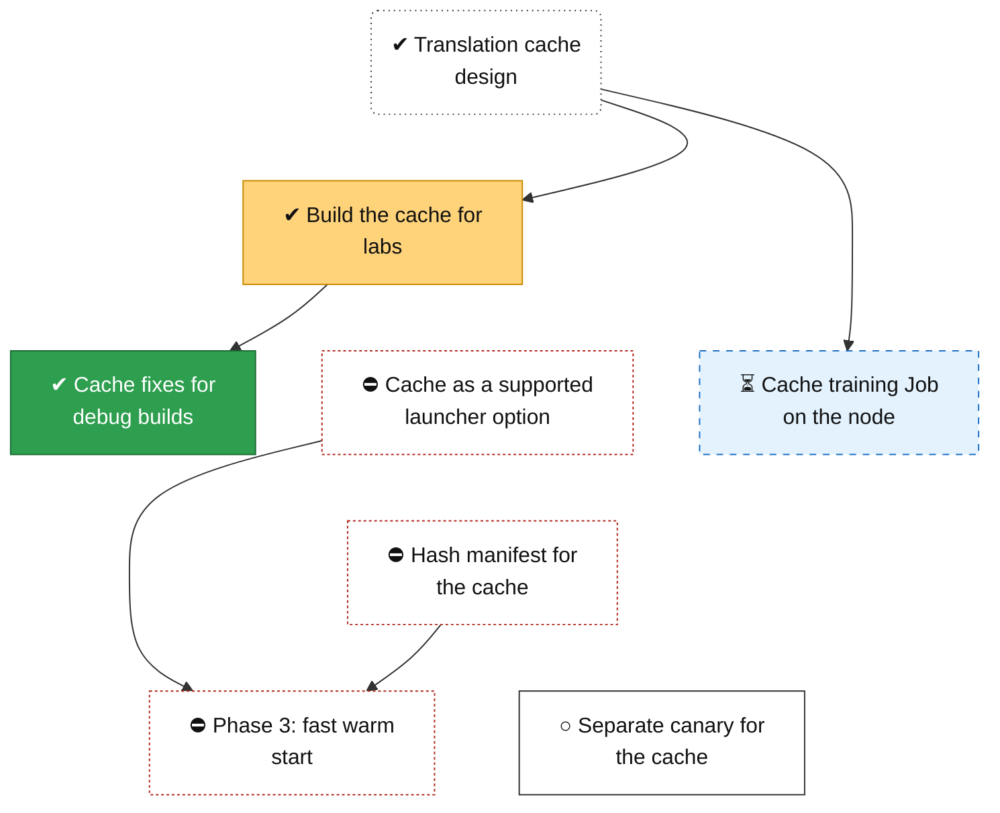

<!-- Generated by build.py from roadmap/nodes.yaml. Do not edit. -->

# cache - translation cache

Scope: Phase 3: the cache across runs, its design, placement and fail-closed checks.

[Back to the page](../../roadmap.md) · [legend](../../roadmap.md#legend)

<!-- BEGIN GENERATED: track-cache -->

<!-- END GENERATED: track-cache -->

## Node table

<!-- BEGIN GENERATED: table-cache -->
| id | title | kind | lane | state | outcome | start | end | depends_on | replaced_by | qualified_by | headline | evidence |
|---|---|---|---|---|---|---|---|---|---|---|---|---|
| `cache-design` | Translation cache design | design | none | done | unrated | 2026-11-12 | 2026-11-20 | perf-startup-options |  |  |  | PR #41; branch translation-cache-design; PR #64; branch lab-startup-ladder; docs/translation-cache.md; docs/adr/0006-read-only-translation-cache.md; lhns/dynamorio#10 |
| `cache-phase2` | Build the cache for labs | feature | none | done | mixed | 2026-11-13 | 2026-11-17 | cache-design |  |  | 0.55 to 0.34 s | PR #50; branch pcache-phase2; PR #56; branch pcache-phase2-rebase; lhns/dynamorio#14; lhns/dynamorio#16; branch lab-pcache-rerun; docs/translation-cache.md |
| `cache-placement` | Where the cache lives | decision | none | done | n/a | 2026-11-17 | 2026-11-17 | cache-design |  |  |  | PR #60; branch adr6-cache-placement; docs/adr/0006-read-only-translation-cache.md |
| `cache-debug-fix` | Cache fixes for debug builds | fix | none | done | very-successful | 2026-11-20 | 2026-11-20 | cache-phase2 |  |  | 0 of 200 bad after | PR #74; branch pin-pcache-lock; lhns/dynamorio#28; docs/plan.md |
| `cache-canary-call` | Canary with or without the cache | decision | none | done | n/a | 2026-11-27 | 2026-11-27 | cache-placement, lab-ivy-gate, prod-release |  |  |  | docs/handover.md; k0s-flux PR #1835 |
| `cache-phase3-gate` | Phase 3: fast warm start | gate | ivy | blocked | unrated |  |  | perf-traces-default, cache-supported-option, cache-integrity |  |  |  | docs/plan.md; docs/translation-cache.md |
| `cache-training-job` | Cache training Job on the node | feature | owner | in-progress | unrated | 2026-11-26 |  | cache-placement, runtime-installer |  |  |  | k0s-flux PR #1835; docs/adr/0006-read-only-translation-cache.md |
| `cache-supported-option` | Cache as a supported launcher option | feature | agent | blocked | unrated |  |  | cache-canary-call |  |  |  | docs/translation-cache.md; launcher/v3compat-run.c; CHANGELOG.md |
| `cache-integrity` | Hash manifest for the cache | feature | agent | blocked | unrated |  |  | cache-canary-call |  |  |  | docs/adr/0006-read-only-translation-cache.md; lhns/v3compat-runtime README |
| `cache-canary-run` | Separate canary for the cache | feature | owner | next | unrated |  |  | cache-canary-call |  |  |  | docs/translation-cache.md |

### Details per node

| id | title | verdict | headline | in plain words | notes | confirmed | waiting on | queue order | order reason |
|---|---|---|---|---|---|---|---|---|---|
| `cache-design` | Translation cache design |  |  | A design for keeping translated blocks across runs, read-only for containers, written by a separate trainer; startup was measured at about 14 us per block. |  |  |  |  |  |
| `cache-phase2` | Build the cache for labs | Phase 1's stop criterion, 40% on `select 42` with traces on, is met on the 7763 (43%) and missed on the 9V45 (39%). | 0.55 to 0.34 s | The cache works for tests and labs: entries are checksummed and position-independent, a bad entry is rejected, and duckdb starts about 40% faster warm. |  |  |  |  |  |
| `cache-placement` | Where the cache lives |  |  | The owner agreed: one root-owned cache directory per node and image digest, written by a training Job, mounted read-only. |  |  |  |  |  |
| `cache-debug-fix` | Cache fixes for debug builds | 200 of 200 runs stopped before, 0 of 200 bad after | 0 of 200 bad after | Debug builds of DynamoRIO stopped on every run with the cache; an option read and a leak are fixed. |  |  |  |  |  |
| `cache-canary-call` | Canary with or without the cache |  |  | Decided: the cluster canary drops the cache; the cache gets its own canary run later, which does not count toward Phase 4. | Owner decision of 2026-11-27. CHANGELOG's line about the cache is corrected. |  |  |  |  |
| `cache-phase3-gate` | Phase 3: fast warm start |  |  | Phase 3's go/no-go: warm duckdb start under 2 s on Ivy Bridge and 40% below cold, under 180 MB, bad entries rejected; met so far only with traces off. | Done when: the gate run passes with the shipped options and ADR 0006 is amended with what Phase 3 learned. |  |  | 3 |  |
| `cache-training-job` | Cache training Job on the node |  |  | A Job on the Ivy Bridge node trains the cache into its own directory, and a root step renames it into the per-image tree; built in k0s-flux #1835, not merged. |  |  | the cache's own canary; the main canary no longer uses it |  |  |
| `cache-supported-option` | Cache as a supported launcher option |  |  | V3COMPAT_CACHE is for tests and labs only; Phase 3 makes it the user option the runtime's read-only mount relies on. | Done when: the launcher documents and supports the cache outside labs, and CHANGELOG says so. |  |  |  |  |
| `cache-integrity` | Hash manifest for the cache |  |  | ADR 0006 starts cache integrity with a hash manifest, fs-verity where the filesystem has it; the runtime checks only ownership so far. | Done when: a cache file whose hash is not in the manifest is refused before DynamoRIO reads it. |  |  |  |  |
| `cache-canary-run` | Separate canary for the cache |  |  | Not started: a second cluster canary that runs with the translation cache; it does not count toward Phase 4's two weeks. | Done when: the cache canary compares byte for byte with native in the cluster. |  |  |  |  |

### Folded items per node

- `cache-design`: Translation cache design
  - The lab prototype cut warm start about 40%, just under the bar on one runner (2026-11-13, session record)
- `cache-phase2`: Build the cache for labs
  - -stable_reach chosen so cached jumps survive the random code-cache offset (2026-11-13, session record)
- `cache-placement`: Where the cache lives
  - ADR 0006 amendment: a directory per image digest, one .pcache per program, PR #84 (2026-11-25, commit 523df4c1)
<!-- END GENERATED: table-cache -->
