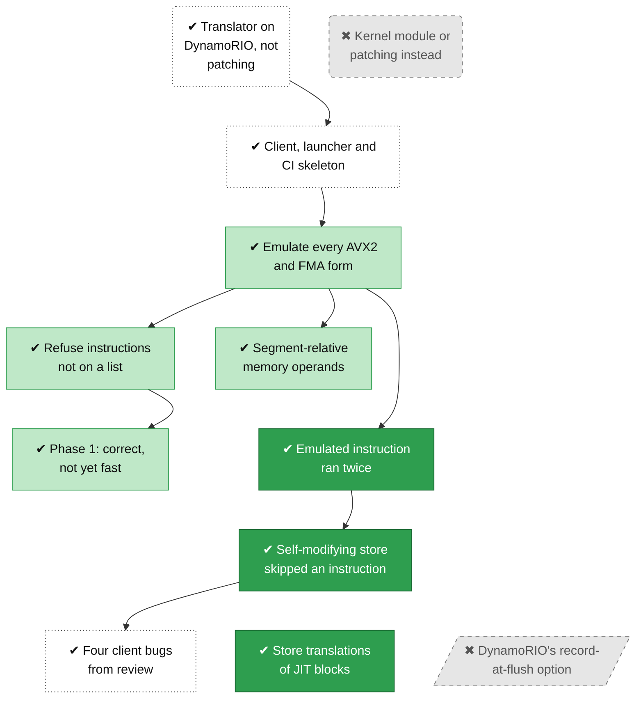

<!-- Generated by build.py from roadmap/nodes.yaml. Do not edit. -->

# client - translator client

Scope: the DynamoRIO client: expansions, the audited list, refusals, fault state.

[Back to the page](../../roadmap.md) · [legend](../../roadmap.md#legend)

<!-- BEGIN GENERATED: track-client -->

<!-- END GENERATED: track-client -->

## Node table

<!-- BEGIN GENERATED: table-client -->
| id | title | kind | lane | state | outcome | start | end | depends_on | replaced_by | qualified_by | headline | evidence |
|---|---|---|---|---|---|---|---|---|---|---|---|---|
| `client-design` | Translator on DynamoRIO, not patching | design | none | done | unrated | 2026-11-03 | 2026-11-03 |  |  |  |  | commit eda4685; commit 1d65ca3; commit 84e2db1; docs/adr/0001-correctness-over-speed.md; docs/adr/0002-same-isa-binary-translator.md; docs/adr/0003-dynamorio-as-the-base.md |
| `client-scaffold` | Client, launcher and CI skeleton | tooling | none | done | unrated | 2026-11-04 | 2026-11-04 | client-design |  |  |  | PR #1; branch scaffold |
| `client-forms` | Emulate every AVX2 and FMA form | feature | none | done | successful | 2026-11-04 | 2026-11-04 | client-scaffold, emu-helpers |  |  |  | PR #3; branch client-emulation; docs/plan.md |
| `client-allowlist` | Refuse instructions not on a list | feature | none | done | successful | 2026-11-04 | 2026-11-04 | client-forms |  |  |  | PR #4; branch native-allowlist; PR #5; branch allow-rcp-split-target; PR #11; branch allow-order-independent; docs/adr/0008-audited-list-keyed-on-shape.md; docs/allowlist.md |
| `client-seg-operands` | Segment-relative memory operands | fix | none | done | successful | 2026-11-05 | 2026-11-05 | client-forms |  |  |  | PR #18; branch fs-operand; PR #21; branch seg-operands |
| `client-block-end` | Emulated instruction ran twice | fix | none | done | very-successful | 2026-11-14 | 2026-11-15 | client-forms, perf-baseline |  |  | 168 wrong values on base, 0 with the fix | PR #54; branch fix-emulated-block-end; docs/plan.md |
| `client-seq-rwx` | Self-modifying store skipped an instruction | fix | none | done | very-successful | 2026-11-15 | 2026-11-15 | client-block-end |  |  | 5 of 5 runs differ from native on base, 0 of 5 with the fix | PR #55; branch seq-rwx; docs/plan.md |
| `client-review-bugs` | Four client bugs from review | fix | none | done | unrated | 2026-11-18 | 2026-11-18 | client-seq-rwx |  |  |  | PR #67; branch cleanup-bugs |
| `client-store-xl8` | Store translations of JIT blocks | fix | none | done | very-successful | 2026-11-19 | 2026-11-20 | fork-flushed-sandboxed |  |  | 400 of 400 runs bad in each mode, the fix 0 of 400 | PR #71; branch fix-xl8-flushed-store; PR #72; branch fix-xl8-flushed-stored; lhns/dynamorio#24; lhns/dynamorio#25; docs/plan.md |
| `client-safe-translate-flushed` | DynamoRIO's record-at-flush option | experiment | none | abandoned | dead-end | 2026-11-19 | 2026-11-19 | fork-flushed-sandboxed |  |  |  | docs/plan.md; PR #72 |
| `client-kernel-module` | Kernel module or patching instead | design | none | abandoned | dead-end | 2026-11-03 | 2026-11-03 |  |  |  |  | docs/adr/0002-same-isa-binary-translator.md; docs/plan.md |
| `client-phase1-gate` | Phase 1: correct, not yet fast | gate | none | done | successful | 2026-11-05 | 2026-11-05 | client-allowlist, launch-static, fork-cache-reset, lab-phase0 |  |  |  | docs/plan.md |

### Details per node

| id | title | verdict | headline | in plain words | notes | confirmed | waiting on | queue order | order reason |
|---|---|---|---|---|---|---|---|---|---|
| `client-design` | Translator on DynamoRIO, not patching |  |  | Run x86-64-v3 programs on AVX-only CPUs with a same-ISA binary translator on DynamoRIO: QEMU was 16-30x slower than native, Intel SDE 100-300x, and in-memory patching missed libraries. |  |  |  |  |  |
| `client-scaffold` | Client, launcher and CI skeleton |  |  | A DynamoRIO client that counts AVX2-era instructions, a launcher and CI, before anything was emulated. |  |  |  |  |  |
| `client-forms` | Emulate every AVX2 and FMA form | Of avxemu's 578 forms, 574 are tested; the 4 refused are the F16C conversions, which Ivy Bridge has natively. |  | Each AVX2, FMA, BMI, LZCNT and MOVBE form is either substituted by an AVX1 equivalent, expanded inline or sent to a helper, with the program's FP flags and faults kept. |  |  |  |  |  |
| `client-allowlist` | Refuse instructions not on a list | **Real programs:** hello, zstd, duckdb's three queries translate 0 forms off the list, on Ivy Bridge and CI; hashes match native. |  | Every instruction shape the translator lets through is on an audited list built from runs on real CPUs; anything else stops the program with status 86 instead of guessing. |  |  |  |  |  |
| `client-seg-operands` | Segment-relative memory operands | Every segment-operand form of an expanded instruction either works or exits 86. |  | Emulated instructions reading thread-local memory (fs:, gs:) used DynamoRIO's segment base and returned zeros; they now use the program's. |  |  |  |  |  |
| `client-block-end` | Emulated instruction ran twice | with `-sandbox_writable` (every writable region sandboxed) 168 wrong values on base, 0 with the fix | 168 wrong values on base, 0 with the fix | A block that ended on an emulated instruction ran that instruction twice, which gave Java's benchmark a wrong checksum. |  |  |  |  |  |
| `client-seq-rwx` | Self-modifying store skipped an instruction | 5 of 5 runs differ from native on base, 0 of 5 with the fix | 5 of 5 runs differ from native on base, 0 of 5 with the fix | In JIT code, a store that changed its own block resumed after the next emulated instruction, skipping it; random self-modifying sequences now match native. |  |  |  |  |  |
| `client-review-bugs` | Four client bugs from review |  |  | A review of the client found four bugs (a refused form skipped in JIT code, a movbe scratch register, a table bound, exec policy init), each fixed with a test. |  |  |  |  |  |
| `client-store-xl8` | Store translations of JIT blocks | `test/flushed_xl8.c` (ctests `flushed-rewrite`, `flushed-span`): base 400 of 400 runs bad in each mode, the fix 0 of 400 | 400 of 400 runs bad in each mode, the fix 0 of 400 | Faults in flushed JIT blocks whose code changed reached the program with pc 0; the client now records each block's translation when it is emitted. |  |  |  |  |  |
| `client-safe-translate-flushed` | DynamoRIO's record-at-flush option | DynamoRIO's `-safe_translate_flushed` (record at flush time) deadlocks |  | DynamoRIO's own option to record translations at flush time deadlocks on every flush of a written page, so it is not used. |  |  |  |  |  |
| `client-kernel-module` | Kernel module or patching instead | Kernel module, eBPF, seccomp patching, ahead-of-time rewriting and hypervisor traps were rejected |  | Emulating in a kernel module, eBPF, seccomp, ahead-of-time rewriting or hypervisor traps was rejected; lzcnt and tzcnt do not even fault on AVX-only CPUs. |  |  |  |  |  |
| `client-phase1-gate` | Phase 1: correct, not yet fast | Phase 1 met (its compute target excludes startup) |  | Phase 1's go/no-go: lzcnt right in a dlopen'ed library, static children followed, duckdb's output correct, compute under 3 s without startup. |  |  |  |  |  |

### Folded items per node

- `client-design`: Translator on DynamoRIO, not patching
  - Apache-2.0 licence; DynamoRIO's LGPL extensions shipped as separate libraries (2026-11-03, commit d3893a5, commit afc4bc8)
  - Project named v3compat; the wrapper became v3compat-runtime (2026-11-03, session record)
- `client-scaffold`: Client, launcher and CI skeleton
  - Stop tracking __pycache__, PR #8 (2026-11-04, commit 076ff7cd, commit dfe2c807)
- `client-seg-operands`: Segment-relative memory operands
  - Share the client's starts helper, PR #16 (2026-11-05, commit 2427dd11, commit 6585fea4)
- `client-review-bugs`: Four client bugs from review
  - Cleanup: shared helpers, dead code, stale docs, PR #68 (2026-11-18, commit 0f31a756, commit 27ad387f, commit fcc3b3f7, commit f675049e, commit 68580570, commit 486235e1)
- `client-kernel-module`: Kernel module or patching instead
  - Kernel-module emulation rejected: it cannot see lzcnt or tzcnt, traps are slow, a bug takes down the node (2026-11-03, session record)
<!-- END GENERATED: table-client -->
