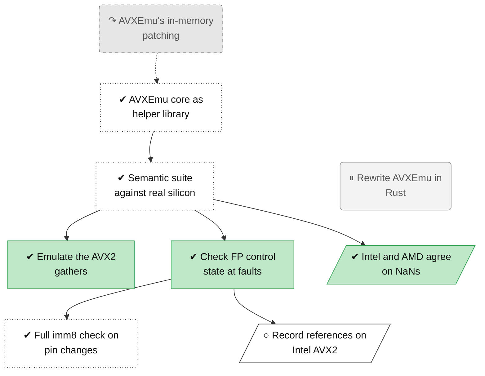

<!-- Generated by build.py from roadmap/nodes.yaml. Do not edit. -->

# emu - instruction emulation

Scope: avxemu helpers and forms, the semantic suite against silicon, MXCSR and FP flags.

[Back to the page](../../roadmap.md) · [legend](../../roadmap.md#legend)

<!-- BEGIN GENERATED: track-emu -->

<!-- END GENERATED: track-emu -->

## Node table

<!-- BEGIN GENERATED: table-emu -->
| id | title | kind | lane | state | outcome | start | end | depends_on | replaced_by | qualified_by | headline | evidence |
|---|---|---|---|---|---|---|---|---|---|---|---|---|
| `emu-preload` | AVXEmu's in-memory patching | design | none | abandoned | superseded | 2026-11-03 | 2026-11-05 |  | emu-helpers |  |  | docs/adr/0005-avxemu-core-as-helpers.md; lhns/avxemu#8 |
| `emu-helpers` | AVXEmu core as helper library | feature | none | done | unrated | 2026-11-03 | 2026-11-05 | client-design |  |  |  | docs/adr/0005-avxemu-core-as-helpers.md; lhns/avxemu#3; lhns/avxemu#4; lhns/avxemu#5; lhns/avxemu#9; lhns/avxemu#13 |
| `emu-semantic-suite` | Semantic suite against real silicon | tooling | none | done | unrated | 2026-11-03 | 2026-11-13 | emu-helpers |  |  |  | lhns/avxemu#2; lhns/avxemu#6; lhns/avxemu#7; docs/plan.md |
| `emu-gathers` | Emulate the AVX2 gathers | feature | none | done | successful | 2026-11-05 | 2026-11-05 | client-forms, emu-semantic-suite |  |  |  | PR #17; branch avxemu-gathers; lhns/avxemu#10 |
| `emu-intel-nan` | Intel and AMD agree on NaNs | experiment | none | done | successful | 2026-11-10 | 2026-11-10 | emu-semantic-suite |  |  |  | PR #29; branch intel-nan; docs/plan.md |
| `emu-mxcsr` | Check FP control state at faults | feature | none | done | successful | 2026-11-26 | 2026-11-26 | emu-semantic-suite |  |  |  | PR #88; commit 489618f3; lhns/avxemu#15 |
| `emu-suite-leftovers` | Retire leftover semantic test pieces | decision | none | done | n/a | 2026-11-27 | 2026-11-27 | emu-mxcsr |  |  |  | docs/handover.md |
| `emu-rust-rewrite` | Rewrite AVXEmu in Rust | design | agent | parked | unrated | 2026-11-03 |  |  |  |  |  | session record |
| `emu-full-imm8` | Full imm8 check on pin changes | feature | none | done | unrated | 2026-11-27 | 2026-11-27 | emu-suite-leftovers |  |  |  | PR #95 |
| `emu-intel-record` | Record references on Intel AVX2 | experiment | gh-runners | next | unrated |  |  | emu-mxcsr |  |  |  | lhns/avxemu docs/vendor-differences.md |

### Details per node

| id | title | verdict | headline | in plain words | notes | confirmed | waiting on | queue order | order reason |
|---|---|---|---|---|---|---|---|---|---|
| `emu-preload` | AVXEmu's in-memory patching | Phase 0 passed and the preload is removed from lhns/avxemu, so the fallback above no longer applies. |  | The earlier approach patched AVX2 instructions in memory; it missed shared libraries, static binaries and JIT code, so only its emulation core was kept. |  |  |  |  |  |
| `emu-helpers` | AVXEmu core as helper library |  |  | AVXEmu's tested instruction semantics became a libc-free static library that the client calls for the forms it does not expand inline. |  |  |  |  |  |
| `emu-semantic-suite` | Semantic suite against real silicon |  |  | Every emulated form is checked against results recorded on real AVX2 CPUs, and v3compat runs the same suite under the client (semantic-hw). |  |  |  |  |  |
| `emu-gathers` | Emulate the AVX2 gathers | `semantic-hw` and `semantic-hw-helpers` (smoke): 574 forms, 0 refused, match the digests recorded on AVX2 silicon, including the gather fault states and restarts. |  | The 16 gather instructions are expanded inline, one real load per element, so a fault mid-gather leaves the same state as hardware. |  |  |  |  |  |
| `emu-intel-nan` | Intel and AMD agree on NaNs | So Intel and AMD agree on NaN priority and on every other recorded value, and the emulation matches both. |  | The reference results were recorded on AMD; a run on Intel CPUs showed the emulation matches Intel too. |  |  |  |  |  |
| `emu-mxcsr` | Check FP control state at faults | with the helper all three semantic tests pass on Xeon 6975P-C and EPYC 7763 (run 45740263716). |  | The suite now varies the FP control register (MXCSR) for every form and compares it after each instruction and at a fault; 17 FMA forms that disagreed were fixed. |  |  |  |  |  |
| `emu-suite-leftovers` | Retire leftover semantic test pieces |  |  | Decided: test/misc_forms.c stays, avxemu's Intel reference file is retired, and the full imm8 semantic-hw becomes a path-filtered CI job. | Owner decision of 2026-11-27; the avxemu and CI changes are done by other work. |  |  |  |  |
| `emu-rust-rewrite` | Rewrite AVXEmu in Rust |  |  | A Rust rewrite of AVXEmu was set aside: the worst bugs were wrong instruction semantics, which a test suite catches and Rust does not. |  |  |  |  |  |
| `emu-full-imm8` | Full imm8 check on pin changes |  |  | CI runs the semantic suite on every imm8 value, inline and helpers only, when the avxemu pin, the DynamoRIO pin or src/expand.c changes. |  |  |  |  |  |
| `emu-intel-record` | Record references on Intel AVX2 |  |  | Not done yet: record avxemu's semantic reference on an Intel AVX2 GitHub runner; runners are assigned at random (Xeon 8370C and 8573C among them), so the job retries until it lands on Intel. | Done when: an Intel reference is recorded; the one known Intel/AMD difference is movbe.m64_g.2 (avxemu docs/vendor-differences.md). |  |  |  |  |

### Folded items per node

- `emu-preload`: AVXEmu's in-memory patching
  - On Ivy Bridge the patching design refused duckdb and zstd at startup (2026-11-03, session record)
- `emu-helpers`: AVXEmu core as helper library
  - Helper archive defined by avxemu's cmake/helpers.cmake, PR #66 (2026-11-18, commit ebbf7c14, commit 5fa60eeb, commit 52216de1)
  - AVXEmu decoder fixes dropped: DynamoRIO decodes (2026-11-04, session record)
  - Nothing else needs to move from v3compat to avxemu (2026-11-13, session record)
- `emu-semantic-suite`: Semantic suite against real silicon
  - Drop the form tests avxemu's suite covers, PR #43 (2026-11-13, commit 3bdbb8e5, commit ba21bf73)
<!-- END GENERATED: table-emu -->
