<!-- Generated by build.py from roadmap/nodes.yaml. Do not edit. -->

# fork - DynamoRIO fork

Scope: lhns/dynamorio fixes: signals, exit, threads, vfork, flushes and translation.

[Back to the page](../../roadmap.md) · [legend](../../roadmap.md#legend)

```mermaid
flowchart TB
    fork_signal_hang["✔ Two signalled<br/>threads looped forever"]
    fork_thread_private[/"✖ Thread-private<br/>caches as a fallback"/]
    fork_build["✔ Build DynamoRIO from<br/>our fork"]
    fork_clone3["✔ Spawned child lost<br/>its signal handlers"]
    fork_cache_reset["✔ Turn off DynamoRIO's<br/>cache reset"]
    fork_ignore_syscalls["✔ Free retired code<br/>during syscalls"]
    fork_vfork_signal["✔ Vfork child dying<br/>hung its parent"]
    fork_signal_unlink["✔ Signal handler freed<br/>running code"]
    fork_map32bit["✔ Low-memory mmap<br/>failed under DynamoRIO"]
    fork_torn_exit["✔ Torn jump when<br/>relinking code"]
    fork_vfork_exit["✔ Exit hung on a vfork<br/>thread"]
    fork_thread_create_fail["✔ Failed thread<br/>creation stalled exit"]
    fork_kill_signal["✔ Hold kill-sent<br/>signals to block end"]
    fork_rebase["✔ Fork rebased onto<br/>upstream master"]
    fork_vfork_exit_race["✔ Races in the vfork<br/>exit fix"]
    fork_regstress_segv>"⏸ One unreproduced<br/>regstress SIGSEGV"]
    fork_trace_teardown["✔ javac crash building<br/>traces"]
    fork_ibl_race["✔ Indirect-branch<br/>table deletion race"]
    fork_trace_emit["✔ New trace freed<br/>under its builder"]
    fork_sig_thread_start["✔ Signal at a new<br/>thread's start"]
    fork_sigxcpu["✔ Kernel-raised<br/>SIGXCPU crashed<br/>DynamoRIO"]
    fork_selfmod_xl8["✔ Write fault in<br/>rebuilt JIT block"]
    fork_exit_sigmask["✔ Signal during a<br/>thread's own exit"]
    fork_safe_spot["✔ Stale permission<br/>after a signal"]
    fork_flushed_sandboxed["✔ JVM aborts at<br/>safepoints"]
    fork_vfork_kill["✔ Vfork child killed<br/>inside DynamoRIO"]
    fork_close_range["✔ Closing all fds took<br/>a minute"]
    fork_signal_deviations>"⏸ Signal behaviour<br/>differing from native"]
    fork_refuse_untranslatable["✔ Stop on<br/>untranslatable faults"]
    fork_selfwrite_flush["✔ Self-written<br/>fragment deleted twice"]
    fork_heap_race["✔ Heap free-list race<br/>in DynamoRIO"]
    fork_selfmod_race["✔ JIT patch raced<br/>block building"]
    fork_exit_sigsegv>"⚠ SIGSEGV at exit<br/>while threads start"]
    fork_bare_dr_hang>"⏸ Bare DynamoRIO hangs<br/>in control runs"]
    fork_signal_hang ~~~ fork_thread_private
    fork_signal_hang ~~~ fork_build
    fork_thread_private ~~~ fork_clone3
    fork_build ~~~ fork_cache_reset
    fork_clone3 ~~~ fork_ignore_syscalls
    fork_cache_reset ~~~ fork_vfork_signal
    fork_ignore_syscalls ~~~ fork_signal_unlink
    fork_vfork_signal ~~~ fork_map32bit
    fork_signal_unlink ~~~ fork_torn_exit
    fork_map32bit ~~~ fork_vfork_exit
    fork_torn_exit ~~~ fork_thread_create_fail
    fork_vfork_exit ~~~ fork_thread_create_fail
    fork_thread_create_fail ~~~ fork_kill_signal
    fork_kill_signal ~~~ fork_rebase
    fork_rebase ~~~ fork_vfork_exit_race
    fork_rebase ~~~ fork_regstress_segv
    fork_rebase ~~~ fork_trace_teardown
    fork_vfork_exit_race ~~~ fork_ibl_race
    fork_regstress_segv ~~~ fork_trace_emit
    fork_trace_teardown ~~~ fork_sig_thread_start
    fork_ibl_race ~~~ fork_sigxcpu
    fork_trace_emit ~~~ fork_selfmod_xl8
    fork_sig_thread_start ~~~ fork_exit_sigmask
    fork_sigxcpu ~~~ fork_safe_spot
    fork_selfmod_xl8 ~~~ fork_flushed_sandboxed
    fork_exit_sigmask ~~~ fork_vfork_kill
    fork_safe_spot ~~~ fork_close_range
    fork_flushed_sandboxed ~~~ fork_signal_deviations
    fork_vfork_kill ~~~ fork_refuse_untranslatable
    fork_close_range ~~~ fork_selfwrite_flush
    fork_signal_deviations ~~~ fork_selfwrite_flush
    fork_refuse_untranslatable ~~~ fork_selfwrite_flush
    fork_selfwrite_flush ~~~ fork_heap_race
    fork_heap_race ~~~ fork_selfmod_race
    fork_heap_race ~~~ fork_exit_sigsegv
    fork_heap_race ~~~ fork_bare_dr_hang
    fork_signal_hang --> fork_thread_private
    fork_signal_hang --> fork_build
    fork_build --> fork_clone3
    fork_build --> fork_cache_reset
    fork_cache_reset --> fork_ignore_syscalls
    fork_clone3 --> fork_vfork_signal
    fork_ignore_syscalls --> fork_signal_unlink
    fork_build --> fork_map32bit
    fork_signal_unlink --> fork_torn_exit
    fork_vfork_signal --> fork_vfork_exit
    fork_vfork_exit --> fork_thread_create_fail
    fork_thread_create_fail --> fork_kill_signal
    fork_kill_signal --> fork_rebase
    fork_torn_exit --> fork_rebase
    fork_map32bit --> fork_rebase
    fork_rebase --> fork_vfork_exit_race
    fork_rebase --> fork_regstress_segv
    fork_rebase --> fork_trace_teardown
    fork_trace_teardown --> fork_ibl_race
    fork_trace_teardown --> fork_trace_emit
    fork_rebase --> fork_sig_thread_start
    fork_sig_thread_start --> fork_sigxcpu
    fork_vfork_exit_race --> fork_exit_sigmask
    fork_exit_sigmask --> fork_safe_spot
    fork_selfmod_xl8 --> fork_flushed_sandboxed
    fork_vfork_exit_race --> fork_vfork_kill
    fork_rebase --> fork_close_range
    fork_vfork_kill --> fork_signal_deviations
    fork_flushed_sandboxed --> fork_selfwrite_flush
    fork_selfwrite_flush --> fork_heap_race
    fork_refuse_untranslatable --> fork_heap_race
    fork_heap_race --> fork_selfmod_race
    classDef vsucc fill:#2e9e4f,stroke:#1b6b34,color:#fff
    classDef succ fill:#bfe8c8,stroke:#2e9e4f,color:#111
    classDef mixed fill:#ffd37a,stroke:#c98a00,color:#111
    classDef bad fill:#f28b82,stroke:#b3261e,color:#111
    classDef dead fill:#e6e6e6,stroke:#777,stroke-dasharray:5 5,color:#555
    classDef inprog fill:#a8cdf5,stroke:#1f6fc5,color:#111
    classDef next fill:#fff,stroke:#333,color:#111
    classDef blocked fill:#fff,stroke:#b3261e,stroke-dasharray:2 2,color:#111
    classDef parked fill:#f3f3f3,stroke:#999,color:#555
    classDef unrated fill:#fff,stroke:#333,stroke-dasharray:1 3,color:#111
    classDef gate fill:#d9c2f0,stroke:#7b3fb5,color:#111
    classDef decided fill:#ece0f7,stroke:#7b3fb5,stroke-dasharray:2 2,color:#111
    classDef finding fill:#ffe0b2,stroke:#d84315,stroke-width:2px,color:#111
    classDef waiting fill:#e3f2fd,stroke:#1f6fc5,stroke-dasharray:5 5,color:#111
    class fork_signal_hang,fork_ignore_syscalls,fork_vfork_signal,fork_signal_unlink,fork_map32bit,fork_torn_exit,fork_vfork_exit,fork_thread_create_fail,fork_kill_signal,fork_vfork_exit_race,fork_trace_teardown,fork_ibl_race,fork_trace_emit,fork_sig_thread_start,fork_sigxcpu,fork_selfmod_xl8,fork_exit_sigmask,fork_safe_spot,fork_flushed_sandboxed,fork_close_range,fork_selfwrite_flush,fork_heap_race,fork_selfmod_race vsucc
    class fork_thread_private dead
    class fork_build,fork_clone3 unrated
    class fork_cache_reset,fork_vfork_kill mixed
    class fork_rebase,fork_refuse_untranslatable succ
    class fork_regstress_segv,fork_signal_deviations,fork_bare_dr_hang parked
    class fork_exit_sigsegv finding
```

<!-- BEGIN GENERATED: track-fork -->

<!-- END GENERATED: track-fork -->

## Node table

<!-- BEGIN GENERATED: table-fork -->
| id | title | kind | lane | state | outcome | start | end | depends_on | replaced_by | qualified_by | headline | evidence |
|---|---|---|---|---|---|---|---|---|---|---|---|---|
| `fork-signal-hang` | Two signalled threads looped forever | fix | none | done | very-successful | 2026-11-03 | 2026-11-04 |  |  |  | 0/1000 | docs/plan.md; commit f01f7fc |
| `fork-thread-private` | Thread-private caches as a fallback | experiment | none | abandoned | dead-end | 2026-11-03 | 2026-11-04 | fork-signal-hang |  |  |  | docs/plan.md; commit f01f7fc |
| `fork-build` | Build DynamoRIO from our fork | tooling | none | done | unrated | 2026-11-04 | 2026-11-04 | client-scaffold, fork-signal-hang, fork-commit-call |  |  |  | PR #2; branch dr-fork-source; docs/adr/0003-dynamorio-as-the-base.md |
| `fork-clone3` | Spawned child lost its signal handlers | fix | none | done | unrated | 2026-11-04 | 2026-11-04 | fork-build |  |  |  | PR #10; branch clone3-root-cause |
| `fork-cache-reset` | Turn off DynamoRIO's cache reset | fix | none | done | mixed | 2026-11-05 | 2026-11-05 | fork-build |  |  |  | PR #12; branch no-enable-reset; docs/adr/0010-no-cache-reset.md; docs/plan.md |
| `fork-ignore-syscalls` | Free retired code during syscalls | fix | none | done | very-successful | 2026-11-05 | 2026-11-05 | fork-cache-reset |  |  | 18.4 KB per region before, 0.0 after | PR #19; branch jit-growth; docs/adr/0011-no-ignored-syscalls.md |
| `fork-vfork-signal` | Vfork child dying hung its parent | fix | none | done | very-successful | 2026-11-05 | 2026-11-05 | fork-clone3 |  |  | 0 of 300 | PR #20; branch vfork-hang |
| `fork-signal-unlink` | Signal handler freed running code | fix | none | done | very-successful | 2026-11-06 | 2026-11-06 | fork-ignore-syscalls |  |  | 0 of 12,000 | PR #23; branch signal-unlink-free; docs/plan.md |
| `fork-map32bit` | Low-memory mmap failed under DynamoRIO | fix | none | done | very-successful | 2026-11-06 | 2026-11-08 | fork-build |  |  | gather 0 of 700 | PR #24; branch map32bit; lhns/dynamorio#1 |
| `fork-torn-exit` | Torn jump when relinking code | fix | none | done | very-successful | 2026-11-10 | 2026-11-10 | fork-signal-unlink |  |  | fix 0 of 102,000 | PR #25; commit da64fe11; branch dr-exit-offset-16; lhns/dynamorio#2; docs/plan.md |
| `fork-vfork-exit` | Exit hung on a vfork thread | fix | none | done | very-successful | 2026-11-10 | 2026-11-10 | fork-vfork-signal |  |  | 0 of 1,200 | PR #26; branch vfork-exit; lhns/dynamorio#3 |
| `fork-thread-create-fail` | Failed thread creation stalled exit | fix | none | done | very-successful | 2026-11-10 | 2026-11-10 | fork-vfork-exit |  |  | 0.4-0.6 s | PR #27; branch thread-exit; lhns/dynamorio#4 |
| `fork-kill-signal` | Hold kill-sent signals to block end | fix | none | done | very-successful | 2026-11-10 | 2026-11-10 | fork-thread-create-fail |  |  | 0 of 190 in each | PR #28; branch kill-signal-hold; lhns/dynamorio#5 |
| `fork-rebase` | Fork rebased onto upstream master | tooling | none | done | successful | 2026-11-10 | 2026-11-11 | fork-kill-signal, fork-torn-exit, fork-map32bit |  |  |  | PR #30; branch rebase-dr-master; docs/plan.md |
| `fork-vfork-exit-race` | Races in the vfork exit fix | fix | none | done | very-successful | 2026-11-11 | 2026-11-11 | fork-vfork-exit, fork-rebase |  |  | 0 of 9,600 runs | PR #31; branch vfork-exit-race; PR #32; branch tidy-suspend-poll; lhns/dynamorio#6; lhns/dynamorio#7 |
| `fork-trace-teardown` | javac crash building traces | fix | none | done | very-successful | 2026-11-12 | 2026-11-12 | fork-rebase, prod-order-of-work |  |  | 0 of 50 | PR #38; branch pin-trace-fix; lhns/dynamorio#8; docs/plan.md; branch lab-perf-trace-diag |
| `fork-ibl-race` | Indirect-branch table deletion race | fix | none | done | very-successful | 2026-11-13 | 2026-11-13 | fork-trace-teardown |  |  | 0 of 120 | PR #47; branch pin-ibl-tag; lhns/dynamorio#11; docs/plan.md |
| `fork-trace-emit` | New trace freed under its builder | fix | none | done | very-successful | 2026-11-13 | 2026-11-13 | fork-trace-teardown |  |  | 0 of 1,872 | PR #51; branch pin-trace-emit; lhns/dynamorio#12; PR #47; docs/plan.md |
| `fork-sig-thread-start` | Signal at a new thread's start | fix | none | done | very-successful | 2026-11-14 | 2026-11-14 | fork-rebase |  |  | 0 of 600 | PR #52; branch pin-sig-thread-start; lhns/dynamorio#15; docs/plan.md |
| `fork-sigxcpu` | Kernel-raised SIGXCPU crashed DynamoRIO | fix | none | done | very-successful | 2026-11-15 | 2026-11-15 | fork-sig-thread-start |  |  | 0 of 20 | PR #57; branch pin-sigxcpu; lhns/dynamorio#17; docs/plan.md |
| `fork-selfmod-xl8` | Write fault in rebuilt JIT block | fix | none | done | very-successful | 2026-11-16 | 2026-11-16 | client-seq-rwx |  |  | 0 of 5 | PR #58; branch pin-selfmod; lhns/dynamorio#18; docs/plan.md |
| `fork-exit-sigmask` | Signal during a thread's own exit | fix | none | done | very-successful | 2026-11-17 | 2026-11-17 | fork-vfork-exit-race |  |  | 0 of 3,000 | PR #59; branch pin-exit-sigmask; lhns/dynamorio#19; docs/plan.md |
| `fork-safe-spot` | Stale permission after a signal | fix | none | done | very-successful | 2026-11-17 | 2026-11-17 | fork-exit-sigmask |  |  | 0 of 114 | PR #61; branch fix-safe-spot-signal; lhns/dynamorio#20; docs/plan.md |
| `fork-flushed-sandboxed` | JVM aborts at safepoints | fix | none | done | very-successful | 2026-11-17 | 2026-11-17 | fork-selfmod-xl8 |  |  | 8 aborts on base `af12842`, 0 with the fix | PR #63; branch fix-xl8-flushed; lhns/dynamorio#21; docs/plan.md |
| `fork-vfork-kill` | Vfork child killed inside DynamoRIO | fix | none | done | mixed | 2026-11-19 | 2026-11-19 | fork-vfork-exit-race |  |  |  | PR #69; branch fix-vfork-kill; lhns/dynamorio#22; docs/plan.md |
| `fork-close-range` | Closing all fds took a minute | fix | none | done | very-successful | 2026-11-19 | 2026-11-19 | fork-rebase |  |  | 0.11-0.15 s after | PR #70; branch fix-close-range; lhns/dynamorio#23; docs/plan.md |
| `fork-refuse-untranslatable` | Stop on untranslatable faults | fix | none | done | successful | 2026-11-20 | 2026-11-20 | client-store-xl8 |  | lab-noop-value-checks |  | PR #73; branch refuse-untranslatable-fault; lhns/dynamorio#26; docs/plan.md |
| `fork-selfwrite-flush` | Self-written fragment deleted twice | fix | none | done | very-successful | 2026-11-20 | 2026-11-20 | fork-flushed-sandboxed |  |  | 6 of 600 and 0 of 600 | lhns/dynamorio#27; docs/plan.md; commit c8c6e30 |
| `fork-heap-race` | Heap free-list race in DynamoRIO | fix | none | done | very-successful | 2026-11-24 | 2026-11-24 | fork-selfwrite-flush, prod-stability-gate |  |  | 6.1e8 against 2,331 | PR #79; branch pin-trace-abort-foreign; lhns/dynamorio#29; docs/plan.md |
| `fork-selfmod-race` | JIT patch raced block building | fix | none | done | very-successful | 2026-11-25 | 2026-11-25 | fork-heap-race, prod-stability-gate |  |  | 960 of 960 against 0 of 960 | PR #81; commit e9997b92; lhns/dynamorio#30; docs/plan.md |
| `fork-exit-sigsegv` | SIGSEGV at exit while threads start | defect | none | in-progress | unrated | 2026-11-25 |  | lab-thread-exit-test |  |  |  | docs/plan.md; commit 8e97372; branch lab-te-exit-amp; branch lab-te-exit-diag |
| `fork-exit-fix` | Keep SIGSEGV safe during exit | decision | owner | next | n/a |  |  | fork-exit-sigsegv |  |  |  | docs/handover.md; docs/plan.md |
| `fork-regstress-segv` | One unreproduced regstress SIGSEGV | defect | none | parked | unrated | 2026-11-11 |  | fork-rebase |  |  |  | docs/plan.md; PR #30 |
| `fork-bare-dr-hang` | Bare DynamoRIO hangs in control runs | defect | none | parked | unrated | 2026-11-26 |  | lab-thread-exit-test |  |  |  | docs/plan.md |
| `fork-commit-call` | Commit to our DynamoRIO fork | decision | none | done | n/a | 2026-11-04 | 2026-11-04 | lab-phase0 |  |  |  | docs/adr/0003-dynamorio-as-the-base.md; session record |
| `fork-signal-deviations` | Signal behaviour differing from native | defect | none | parked | unrated | 2026-11-19 |  | fork-vfork-kill |  |  |  | session record |

### Details per node

| id | title | verdict | headline | in plain words | notes | confirmed | waiting on | queue order | order reason |
|---|---|---|---|---|---|---|---|---|---|
| `fork-signal-hang` | Two signalled threads looped forever | Go tight loop + GC \| 356/1000 \| 0/1000 | 0/1000 | Two threads signalled in one shared code fragment looped forever under stock DynamoRIO, in Go programs and C alike; fixed in the fork before v3compat started. |  |  |  |  |  |
| `fork-thread-private` | Thread-private caches as a fallback | `-thread_private` is not a fallback: it hung too. |  | Giving each thread its own code cache did not avoid the signal hang. |  |  |  |  |  |
| `fork-build` | Build DynamoRIO from our fork |  |  | DynamoRIO is built from source from lhns/dynamorio at a pinned commit; fixes go to the fork only, never upstream. |  |  |  |  |  |
| `fork-clone3` | Spawned child lost its signal handlers |  |  | glibc's posix_spawn cleared DynamoRIO's own signal handlers in the child, which then died; the fork now clears only the program's. |  |  |  |  |  |
| `fork-cache-reset` | Turn off DynamoRIO's cache reset | **`-no_enable_reset`** in the launcher: a mitigation, because flags in that window (i#400) and the client under forced resets (likely i#4219) are still wrong, and reset hangs under code churn. |  | About 1 duckdb run in 10 gave wrong results or crashed because a full cache reset moves threads incorrectly; the reset is off and one register bug is fixed. |  |  |  |  |  |
| `fork-ignore-syscalls` | Free retired code during syscalls | Growth over 3,000 regions with a thread waiting in `pthread_join`: 18.4 KB per region before, 0.0 after. | 18.4 KB per region before, 0.0 after | With reset off, code retired while a thread waited in a system call was never freed; every system call now passes a point where it is. |  |  |  |  |  |
| `fork-vfork-signal` | Vfork child dying hung its parent | `test/vfork_sig.c`, new: before, 9 of 9 hung and all 6 ctest variants timed out. After, 0 of 300 (at most 1%, 95%), all pass; native passes. | 0 of 300 | A vfork child killed by a signal no longer leaves its parent waiting forever. |  |  |  |  |  |
| `fork-signal-unlink` | Signal handler freed running code | without the change, 17 of 9,000 on main and 21 of 12,000 on the same lab with an unrelated change; with it, 0 of 12,000 (at most 0.025%, 95%) | 0 of 12,000 | A signal could free the code fragment its own thread was running, a rare crash that could also have run wrong code. |  |  |  |  |  |
| `fork-map32bit` | Low-memory mmap failed under DynamoRIO | After, run 42227141671 (fork 1b8b780; 216923a differs only in a comment): gather 0 of 700, the mmap 0 of 600, forced case 0 of 300. | gather 0 of 700 | DynamoRIO's code reservation sometimes covered the whole range MAP_32BIT allocations must come from; it now falls back to a free range below 2 GB. |  |  |  |  |  |
| `fork-torn-exit` | Torn jump when relinking code | base 6 of 24,000, fix 0 of 102,000 (at most 0.003%, 95%) | fix 0 of 102,000 | On AMD Zen 5, a jump patched by another thread could be read half old, half new; patched offsets now never straddle 16 bytes. |  |  |  |  |  |
| `fork-vfork-exit` | Exit hung on a vfork thread | After (8ad77ff): 0 of 1,200 scenarios bad under the client and 0 of 1,200 on DynamoRIO alone (at most 0.25%, 95%). | 0 of 1,200 | A process ending while one thread waited in vfork hung every time; that thread is now left to the kernel. |  |  |  |  |  |
| `fork-thread-create-fail` | Failed thread creation stalled exit | Every creation failing, after (a900662, the same code as 2191454 on x64): 0.4-0.6 s; RSS 6 MB after 64,000 failures. | 0.4-0.6 s | A thread that failed to start, for example at a thread limit, made every later exit wait 51 s and leaked its stack. |  |  |  |  |  |
| `fork-kill-signal` | Hold kill-sent signals to block end | `regstress xlsig` after: 0 of 190 in each (at most 1.6%, 95%) on EPYC 7763, 9V74, 9V45 and Xeon 8573C, with 4,000-8,000 signals a run at an emulated instruction. | 0 of 190 in each | Some signals sent by another thread were delivered in the middle of an emulated instruction with wrong register state; they now wait for the block's end. |  |  |  |  |  |
| `fork-rebase` | Fork rebased onto upstream master | Upstream had fixed none of these bugs, so no fork commit was dropped. |  | The fork's fixes moved from a 2025 base onto current upstream DynamoRIO (branch rebase-master-20261110). |  |  |  |  |  |
| `fork-vfork-exit-race` | Races in the vfork exit fix | After the fix that is 0 of 9,600 runs, at most 0.16% per way of ending (95%). | 0 of 9,600 runs | The vfork exit fix could still hang or abort under load; both races are fixed and tested with eight copies at once. |  |  |  |  |  |
| `fork-trace-teardown` | javac crash building traces | javac before: 8 of 8 crash under the client, 7 of 8 with an empty client; after: 0 of 50 each in libdynamorio, Java benchmark 0 of 12. | 0 of 50 | javac and Java crashed under any DynamoRIO client while traces were built; per-block lists are now freed with the trace. |  |  |  |  |  |
| `fork-ibl-race` | Indirect-branch table deletion race | DynamoRIO alone 86 of 120 bad before, 0 of 120 after; under the client 49 of 120, 0 of 120. | 0 of 120 | A thread could read a half-retired lookup entry and jump to a bogus address; it now keeps the tag it matched. |  |  |  |  |  |
| `fork-trace-emit` | New trace freed under its builder | With both fixes against `0bd5cd8`, interleaved, defaults (run 43437004196): status 255 in 9 of 1,872 runs before and 0 of 1,872 after. | 0 of 1,872 | A freshly built trace could be freed by a concurrent flush before its thread entered it; it is now looked up again. |  |  |  |  |  |
| `fork-sig-thread-start` | Signal at a new thread's start | 600 of 600 bad before, 0 of 600 after, under the client and on DynamoRIO alone. | 0 of 600 | A signal reaching a thread right after its creation killed the process; new threads now start with signals blocked until DynamoRIO is ready. |  |  |  |  |  |
| `fork-sigxcpu` | Kernel-raised SIGXCPU crashed DynamoRIO | regstress kio under the client 20 of 20 bad before, 0 of 20 after; block_end kio 10 of 10 and 0 of 10 | 0 of 20 | SIGXCPU raised by the kernel inside DynamoRIO's own code aborted the process; it is now always delayed to a safe point. |  |  |  |  |  |
| `fork-selfmod-xl8` | Write fault in rebuilt JIT block | 5 of 5 runs differ on main, inline and helpers only, 0 of 5 with the fix | 0 of 5 | A write fault in sandboxed JIT code was translated against a wrongly rebuilt block and resumed at address 0; it is now translated correctly or stops the process. |  |  |  |  |  |
| `fork-exit-sigmask` | Signal during a thread's own exit | `vfork_exit_dyn 20` under the client, interleaved, EPYC 7763 (run 43956311210): 82 of 3,000 bad on base `19fea7e`, 0 of 3,000 with the fix. | 0 of 3,000 | A signal arriving while a thread was exiting aborted the process ('multiple native handlers'); signals now stay blocked through the exit. |  |  |  |  |  |
| `fork-safe-spot` | Stale permission after a signal | DynamoRIO alone 106 of 114 bad on base `521016e`, 0 of 114 with the fix; under the client 99 of 114 and 1 of 114 (one late reap). | 0 of 114 | A signal at a wait point left a stale permission that later made fork stall for about 50 s; it is now cleared. |  |  |  |  |  |
| `fork-flushed-sandboxed` | JVM aborts at safepoints | Bench's `arrays` kernel, a safepoint every millisecond, 400 runs an arm, interleaved, 20 runners (run 44141984403): 8 aborts on base `af12842`, 0 with the fix | 8 aborts on base `af12842`, 0 with the fix | A fault in a flushed JIT block was translated against a sandboxed rebuild and reached the JVM with pc 0 (status 134 aborts); such rebuilds now stay as built. |  |  |  |  |  |
| `fork-vfork-kill` | Vfork child killed inside DynamoRIO | This is option 2 (the child holds less) with option 3 (a clean end) as the backstop. Option 2 alone was not enough |  | A vfork child SIGKILLed inside DynamoRIO hung or crashed its parent; now the parent goes on, or the process ends with status 89 when the child died holding a lock. |  |  |  |  |  |
| `fork-close-range` | Closing all fds took a minute | Main's pin `5693e56` against the fix, interleaved, 3 reps, EPYC 7763 (run 44507982244): 37.7-41.1 s before, 0.11-0.15 s after, under the client and alone. | 0.11-0.15 s after | Python's subprocess closes every fd up to INT_MAX, and DynamoRIO checked each one, so one subprocess call took about a minute. |  |  |  |  |  |
| `fork-refuse-untranslatable` | Stop on untranslatable faults | with the fix 60 of 60 stop with status 40 and the message, both arms (run 44623652835). |  | A fault in deleted code whose state cannot be recovered now stops the process with status 40 instead of handing the program pc 0. |  |  |  |  |  |
| `fork-selfwrite-flush` | Self-written fragment deleted twice | unfixed against fixed in the same jobs 6 of 600 and 0 of 600 (run 44631011188) | 6 of 600 and 0 of 600 | A fragment that wrote its own code was deleted while a flush could unlink it at the same moment (debug asserts); it is now deleted safely. |  |  |  |  |  |
| `fork-heap-race` | Heap free-list race in DynamoRIO | overlaps 1 of 4,999 against 0 of 5,000 and cross-thread small-block heap operations 6.1e8 against 2,331 (run 45128633686) | 6.1e8 against 2,331 | A flushing thread freed another thread's instruction list while that thread decoded into it, corrupting the heap; the rare crash that blocked production. | The plan says the proof rests on the overlap count; the crash counts only agree. |  |  |  |  |
| `fork-selfmod-race` | JIT patch raced block building | the fix 0 in each; the reproducer 960 of 960 against 0 of 960, under the client and alone. | 960 of 960 against 0 of 960 | A JIT patching a method while DynamoRIO copied it gave a block made of two different versions of the code (the status 255 crash); blocks are now built from one read. |  |  |  |  |  |
| `fork-exit-sigsegv` | SIGSEGV at exit while threads start |  |  | When a process is already dying from a program fault, a thread starting at that moment can crash in DynamoRIO's init; the mechanism is confirmed, the fix is not done. | Mechanism confirmed in lab runs 45805324695 and 45805304984; the code-128 failures are unexplained. |  | the owner's call on a fork fix |  |  |
| `fork-exit-fix` | Keep SIGSEGV safe during exit |  |  | The owner decides whether the fork should keep SIGSEGV handled while DynamoRIO runs the default action of a fatal signal. | Open owner decision 3 in docs/handover.md. |  |  |  |  |
| `fork-regstress-segv` | One unreproduced regstress SIGSEGV |  |  | One signal-stress run crashed in CI on the rebased fork and was not seen again in 2,000 reruns. |  |  |  |  |  |
| `fork-bare-dr-hang` | Bare DynamoRIO hangs in control runs |  |  | DynamoRIO without our client, and with an empty client, hangs in about 12-15% of control runs; v3compat's client never did. |  |  |  |  |  |
| `fork-commit-call` | Commit to our DynamoRIO fork |  |  | After Phase 0 the owner accepted the ADRs and committed to DynamoRIO built from our own fork, with nothing posted upstream. |  |  |  |  |  |
| `fork-signal-deviations` | Signal behaviour differing from native |  |  | A lab with realistic signals found differences from native: a vfork child dies of a signal it ignores before exec, Java crashed 3 times in 24 under SIGTERM storms, and any SIGKILLed child ends the process with status 89. Its Python spawn stall was the close_range fix. | Found in a session lab, not written up in the plan yet. |  |  |  |  |

### Folded items per node

- `fork-build`: Build DynamoRIO from our fork
  - Fork fixes for lost flags and the movbe operand size (2026-11-04, session record)
- `fork-torn-exit`: Torn jump when relinking code
  - First fix by block padding refuted: 8 of 24,000 still crashed (2026-11-09, session record)
- `fork-rebase`: Fork rebased onto upstream master
  - Allowlist, duckdb and stress checks pass on the Ivy Bridge node at the new pin (2026-11-11, session record)
- `fork-vfork-exit-race`: Races in the vfork exit fix
  - Bisect of the rare vfork_exit failure: a steady 0.24%, not a regression (2026-11-15, session record)
- `fork-trace-teardown`: javac crash building traces
  - The javac crash is neither the memory abort nor the protection switch-back (2026-11-12, session record)
  - Owner: fix the JVM crashes in the fork, no launcher workaround (2026-11-12, session record)
- `fork-sig-thread-start`: Signal at a new thread's start
  - Rerun of open items on the new pin: javac's 2% crash and the thread-start kill closed, PR #62 (2026-11-17, commit 6fe20853, commit f0ec7168)
  - javac failures under DynamoRIO alone tracked as a separate bug, later closed by the signal fixes (2026-11-12, session record)
- `fork-flushed-sandboxed`: JVM aborts at safepoints
  - Traces ruled out: the JVM aborts also happen with traces off (2026-11-17, session record)
- `fork-refuse-untranslatable`: Stop on untranslatable faults
  - Owner: the refusal ends with DynamoRIO's status 40, no new code (2026-11-20, session record)
- `fork-heap-race`: Heap free-list race in DynamoRIO
  - Stability gate counts: the heap crash recurs on cc4fdfd; the flusher lead refuted, PR #78 (2026-11-22, commit 5fc6e004, commit ca5cf9be, commit 7d7b590f, commit 049f57b6, commit 9dd6bb9d)
  - Fix A narrowed: handing over the whole trace would use freed memory (2026-11-22, session record)
- `fork-selfmod-race`: JIT patch raced block building
  - Plan corrections: the Bench workload and the status 134 description, PR #80 (2026-11-24, commit 2b0709ef, commit aacbff8f, commit 5c2cd890)
  - Status 255 not reproduced in 1,920 runs on the then pin (2026-11-18, session record)
  - Owner: fix crash 2 rather than document it as a limit (2026-11-22, session record)
  - First reading refuted: the crash address is never-allocated code space, not freed cache (2026-11-22, session record)
  - First fix computed rip-relative addresses from the copy; revised (2026-11-24, session record)
  - Status 134 attributed to the same race, closed by inference (2026-11-24, session record)
- `fork-exit-sigsegv`: SIGSEGV at exit while threads start
  - Normal exits are clean: the crash needs a process already dying from a fault (2026-11-26, session record)
<!-- END GENERATED: table-fork -->
