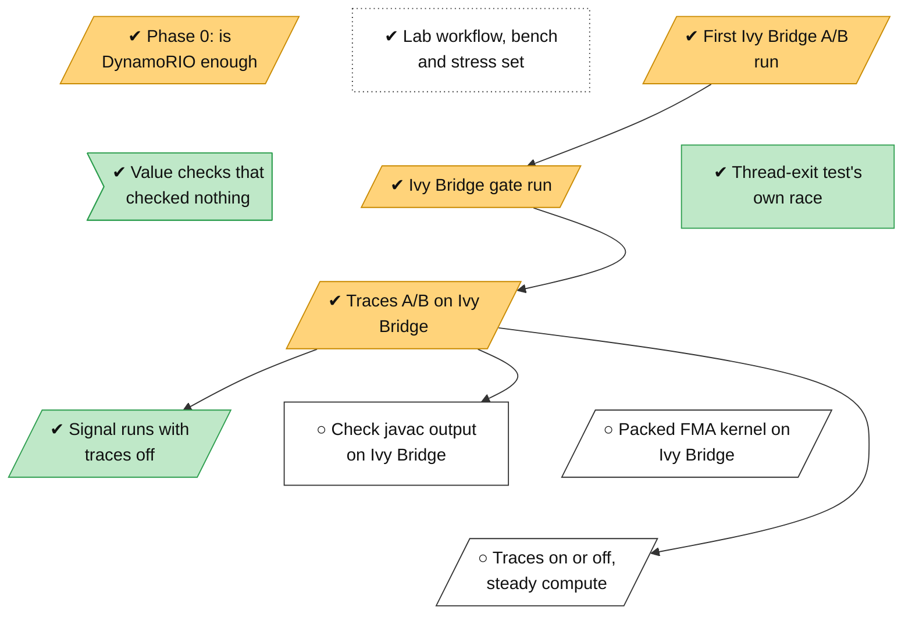

<!-- Generated by build.py from roadmap/nodes.yaml. Do not edit. -->

# lab - labs and measurement

Scope: lab workflow, stress set, Ivy Bridge runs, results write-ups.

[Back to the page](../../roadmap.md) · [legend](../../roadmap.md#legend)

<!-- BEGIN GENERATED: track-lab -->

<!-- END GENERATED: track-lab -->

## Node table

<!-- BEGIN GENERATED: table-lab -->
| id | title | kind | lane | state | outcome | start | end | depends_on | replaced_by | qualified_by | headline | evidence |
|---|---|---|---|---|---|---|---|---|---|---|---|---|
| `lab-phase0` | Phase 0: is DynamoRIO enough | experiment | none | done | mixed | 2026-11-03 | 2026-11-04 | client-design |  |  |  | commit e9ed94e; docs/plan.md |
| `lab-tooling` | Lab workflow, bench and stress set | tooling | none | done | unrated | 2026-11-12 | 2026-11-14 | fork-rebase |  |  |  | PR #36; branch handover; PR #37; branch howto-crash-recipe; PR #49; branch lab-build-fails; PR #53; branch stress-short-runs; docs/howto.md; AGENTS.md; branch dr-suite; branch lab-perf-probe3 |
| `lab-ivy-ab` | First Ivy Bridge A/B run | experiment | none | done | mixed | 2026-11-20 | 2026-11-20 | cache-phase2, prod-triage |  |  |  | PR #75; branch ivy-ab; PR #77; docs/plan.md |
| `lab-targets` | Approve Phase 2 and 3 targets | decision | none | done | n/a | 2026-11-22 | 2026-11-22 | lab-ivy-ab |  |  |  | docs/plan.md; PR #77 |
| `lab-noop-value-checks` | Value checks that checked nothing | defect | none | done | unrated | 2026-11-24 | 2026-11-24 | fork-refuse-untranslatable |  |  |  | PR #80; branch plan-c134-corrections; docs/plan.md |
| `lab-ivy-gate` | Ivy Bridge gate run | experiment | none | done | mixed | 2026-11-25 | 2026-11-25 | lab-targets, fork-selfmod-race |  |  |  | PR #82; commit 45be5abf; docs/plan.md |
| `lab-method-call` | Lab method left to the agents | decision | none | done | n/a | 2026-11-26 | 2026-11-26 | lab-ivy-gate |  |  |  | docs/plan.md; PR #89 |
| `lab-ivy-traces` | Traces A/B on Ivy Bridge | experiment | none | done | mixed | 2026-11-26 | 2026-11-26 | lab-method-call |  |  |  | PR #89; commit 7873a0f6; PR #90; commit 8e97372e; docs/plan.md; branch ivy-traces |
| `lab-ivy-traces-signal` | Signal runs with traces off | experiment | none | done | successful | 2026-11-26 | 2026-11-26 | lab-ivy-traces |  |  |  | docs/plan.md |
| `lab-thread-exit-test` | Thread-exit test's own race | fix | none | done | successful | 2026-11-25 | 2026-11-26 | fork-thread-create-fail |  |  |  | PR #86; commit 0c5c0f8f; docs/plan.md |
| `lab-javac-digest` | Check javac output on Ivy Bridge | tooling | agent | next | unrated |  |  | lab-ivy-traces |  |  |  | docs/plan.md |
| `lab-fma-ivy` | Packed FMA kernel on Ivy Bridge | experiment | ivy | next | unrated |  |  | perf-fma-packed |  |  |  | docs/plan.md |
| `lab-traces-steady` | Traces on or off, steady compute | experiment | ivy | next | unrated |  |  | perf-traces-default |  |  |  | docs/plan.md |

### Details per node

| id | title | verdict | headline | in plain words | notes | confirmed | waiting on | queue order | order reason |
|---|---|---|---|---|---|---|---|---|---|
| `lab-phase0` | Phase 0: is DynamoRIO enough | Phase 0 (is DynamoRIO good enough) is done; its startup criterion was revised after seeing results to cold startup under 5 s on Ivy Bridge |  | DynamoRIO alone was measured on duckdb, zstd, Node and Java: fast enough on long runs, slow to start, so the startup criterion was relaxed with the owner's approval. |  |  |  |  |  |
| `lab-tooling` | Lab workflow, bench and stress set |  |  | Lab jobs run on lab-* branches with base and change interleaved in one job; a fixed stress set (duckdb, signal and register stress) runs on every fork pin. |  |  |  |  |  |
| `lab-ivy-ab` | First Ivy Bridge A/B run | Treat these as upper bounds; the compute-less-startup difference is too noisy to gate on. |  | The first measurements on the real Ivy Bridge node, in a pod on kube-worker-04; the node is shared and busy, so the numbers are upper bounds. |  |  |  |  |  |
| `lab-targets` | Approve Phase 2 and 3 targets |  |  | The owner approved the gates: inline forms under 6 ns, helpers under 100 ns, compute under 2 s, 0 bad in 1,000 signal runs, warm startup under 2 s and 40% below cold. |  |  |  |  |  |
| `lab-noop-value-checks` | Value checks that checked nothing |  |  | Several Java labs compared output lines main's benchmark does not print, so their '0 wrong values' checked nothing; the plan was corrected. |  |  |  |  |  |
| `lab-ivy-gate` | Ivy Bridge gate run | met only with traces off (warm 1.76 and 1.92 s, 51-52% below cold with the same options |  | On Ivy Bridge the signal gate was met (0 bad of 1,000) and the startup gate only with traces off; the compute gate could not run on the busy node. |  |  |  |  |  |
| `lab-method-call` | Lab method left to the agents |  |  | The owner left how to restrict the Ivy Bridge lab to the agents; gates now use the low end of interleaved rounds instead of waiting for a quiet node. |  |  |  |  |  |
| `lab-ivy-traces` | Traces A/B on Ivy Bridge | Three rounds under load: the sign is clear, the size is not. |  | Default, traces off and a higher trace threshold were interleaved on Ivy Bridge: traces off used the least CPU on javac and java; the compute query was within noise. |  |  |  |  |  |
| `lab-ivy-traces-signal` | Signal runs with traces off | Traces off meets Phase 2's signal gate, as the default did. |  | The traces A/B's last section: 1,000 signal-injection runs with traces off on kube-worker-04, none bad. |  |  |  |  |  |
| `lab-thread-exit-test` | Thread-exit test's own race | The cause is the test, not DynamoRIO: it crashes natively too. |  | The thread-exit test crashed now and then because it detached threads racily; natively too. Threads are now created detached. |  |  |  |  |  |
| `lab-javac-digest` | Check javac output on Ivy Bridge |  |  | The Ivy Bridge lab compares duckdb and Java outputs across option sets but prints no digest for javac's output, so a wrong compile would go unseen. | Done when: lab/ivy-ab.sh prints a javac output digest and compares it across option sets. |  |  |  |  |
| `lab-fma-ivy` | Packed FMA kernel on Ivy Bridge |  |  | The packed-FMA speedup was measured on six runner CPUs but not on Ivy Bridge, where helpers cost 4-5x more. | Done when: bench/fma's packed rows, base against the pin, are in plan.md from one interleaved Ivy Bridge job. |  |  | 2 | after the running signal job: one Job at a time on the node |
| `lab-traces-steady` | Traces on or off, steady compute |  |  | Not measured yet: a long steady-compute workload with traces on and off, interleaved in one job on kube-worker-04, to check the traces-off default where traces should help most. | Done when: both arms' CPU and wall times from one interleaved Ivy Bridge job are in plan.md. |  |  |  |  |

### Folded items per node

- `lab-phase0`: Phase 0: is DynamoRIO enough
  - Startup target set after the results: cold start under 5 s, Java out of scope then (2026-11-03, session record)
  - Compute and startup targets measured separately, startup left to the cache (2026-11-04, session record)
- `lab-tooling`: Lab workflow, bench and stress set
  - Cleanup: shrink the plan, state facts in README, PR #15 (2026-11-05, commit e2d88147, commit 07303359)
  - Slow signal stress traced to code placement on one CPU model, accepted as noise (2026-11-14, session record)
- `lab-ivy-ab`: First Ivy Bridge A/B run
  - Phase 2 measure fixed before the run: compute time without startup (2026-11-20, session record)
- `lab-targets`: Approve Phase 2 and 3 targets
  - Warm cache on Ivy Bridge 1.7 s with traces off, far from the old 0.5 s goal; revised by the owner (2026-11-18, session record)
- `lab-method-call`: Lab method left to the agents
  - Cordoning the node or keeping CI runners off it rejected by the owner (2026-11-26, session record)
<!-- END GENERATED: table-lab -->
