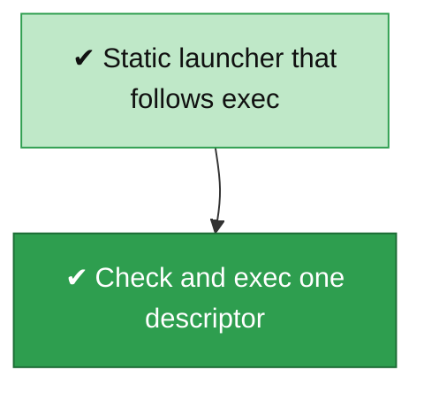

<!-- Generated by build.py from roadmap/nodes.yaml. Do not edit. -->

# launch - launcher and exec

Scope: the static launcher, exec follow, /proc/self/exe, privilege refusals.

[Back to the page](../../roadmap.md) · [legend](../../roadmap.md#legend)

<!-- BEGIN GENERATED: track-launch -->

<!-- END GENERATED: track-launch -->

## Node table

<!-- BEGIN GENERATED: table-launch -->
| id | title | kind | lane | state | outcome | start | end | depends_on | replaced_by | qualified_by | headline | evidence |
|---|---|---|---|---|---|---|---|---|---|---|---|---|
| `launch-static` | Static launcher that follows exec | feature | none | done | successful | 2026-11-04 | 2026-11-04 | client-scaffold |  |  |  | PR #6; branch launcher-exec; PR #7; branch readlink-short-buffer; docs/adr/0009-static-launcher-no-drrun.md; docs/plan.md |
| `launch-exec-error-call` | Refused exec fails with an errno | decision | none | done | n/a | 2026-11-04 | 2026-11-04 | launch-static |  |  |  | PR #9; docs/adr/0009-static-launcher-no-drrun.md |
| `launch-refused-exec` | Check and exec one descriptor | fix | none | done | very-successful | 2026-11-04 | 2026-11-04 | launch-exec-error-call |  |  | Now 0 of 120 each | PR #9; branch refused-exec-returns-error |

### Details per node

| id | title | verdict | headline | in plain words | notes | confirmed | waiting on | queue order | order reason |
|---|---|---|---|---|---|---|---|---|---|
| `launch-static` | Static launcher that follows exec | On Ivy Bridge, under Docker's default seccomp: ctest passes except `docker`, skipped as the dev container has no docker. |  | v3compat-run is a static binary that starts DynamoRIO directly and keeps translating across exec, so child programs never run untranslated. |  |  |  |  |  |
| `launch-exec-error-call` | Refused exec fails with an errno |  |  | The owner chose that an exec the client refuses returns an error to the caller instead of ending the process. |  |  |  |  |  |
| `launch-refused-exec` | Check and exec one descriptor | On the previous code a refused file ran in 17 of 80 (swap), 8 of 80 (script swap) and 27 of 80 (unreadable flip, untranslated) runs on a host without AVX2. Now 0 of 120 each. | Now 0 of 120 each | A refused exec returns EPERM or ENOEXEC, and the file is checked and executed through one descriptor, so swapping it in between cannot bypass the check. |  |  |  |  |  |
<!-- END GENERATED: table-launch -->
