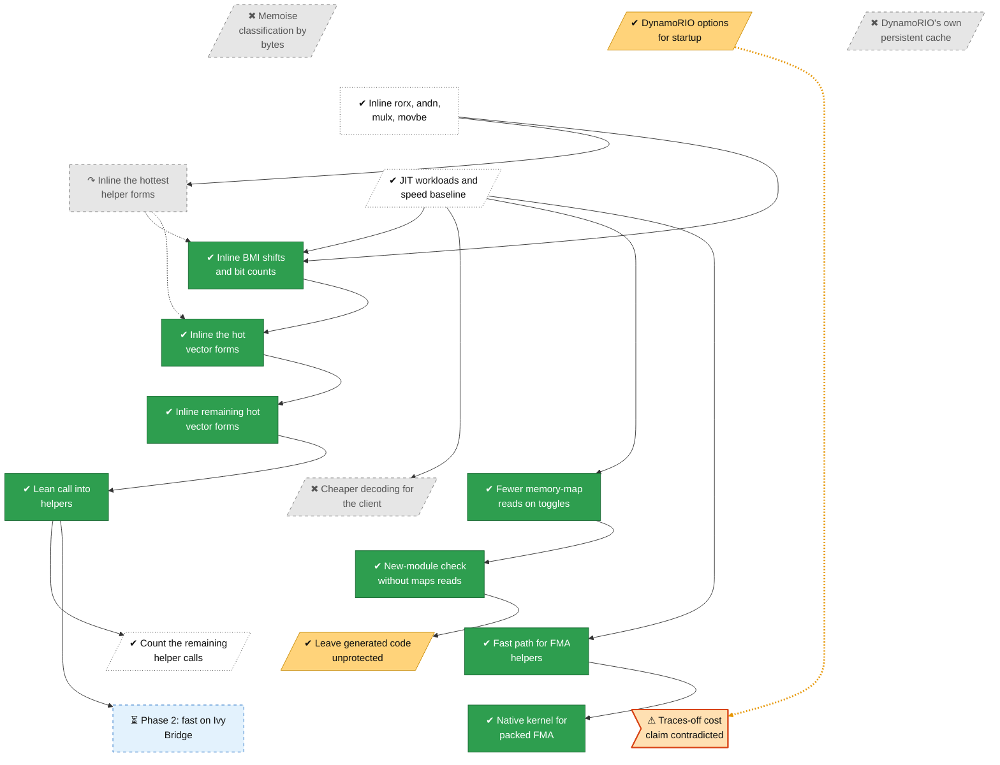

<!-- Generated by build.py from roadmap/nodes.yaml. Do not edit. -->

# perf - performance

Scope: Phase 2: inline forms, helper calls, DynamoRIO overhead, option choices.

[Back to the page](../../roadmap.md) · [legend](../../roadmap.md#legend)

<!-- BEGIN GENERATED: track-perf -->

<!-- END GENERATED: track-perf -->

## Node table

<!-- BEGIN GENERATED: table-perf -->
| id | title | kind | lane | state | outcome | start | end | depends_on | replaced_by | qualified_by | headline | evidence |
|---|---|---|---|---|---|---|---|---|---|---|---|---|
| `perf-startup-options` | DynamoRIO options for startup | experiment | none | done | mixed | 2026-11-05 | 2026-11-05 | client-allowlist |  | perf-traces-claim |  | PR #14; branch startup-time; branch prof-scratch; branch startup-bench |
| `perf-memo-classify` | Memoise classification by bytes | experiment | none | abandoned | dead-end | 2026-11-05 | 2026-11-05 | client-allowlist |  |  |  | PR #14 |
| `perf-persist` | DynamoRIO's own persistent cache | experiment | none | abandoned | dead-end | 2026-11-05 | 2026-11-13 | client-allowlist |  |  |  | PR #14; docs/plan.md |
| `perf-inline-bmi` | Inline rorx, andn, mulx, movbe | feature | none | done | unrated | 2026-11-05 | 2026-11-05 | client-forms |  |  |  | PR #13; branch inline-bmi |
| `perf-speed-inline` | Inline the hottest helper forms | feature | none | abandoned | superseded | 2026-11-05 | 2026-11-12 | perf-inline-bmi | perf-inline-scalar, perf-inline-vec |  |  | PR #22; branch speed-inline; PR #33 |
| `perf-baseline` | JIT workloads and speed baseline | experiment | none | done | unrated | 2026-11-12 | 2026-11-12 | prod-order-of-work |  |  |  | docs/plan.md; PR #36 |
| `perf-inline-scalar` | Inline BMI shifts and bit counts | feature | none | done | very-successful | 2026-11-12 | 2026-11-12 | perf-inline-bmi, perf-baseline |  |  | 80-85 to 0.6-1.7 ns | PR #33; branch inline-bmi-scalar; docs/plan.md |
| `perf-inline-vec` | Inline the hot vector forms | feature | none | done | very-successful | 2026-11-12 | 2026-11-12 | perf-inline-scalar |  |  | about 14 to 2.2 ns | PR #35; branch inline-vec; docs/plan.md |
| `perf-inline-xmm` | Inline remaining hot vector forms | feature | none | done | very-successful | 2026-11-12 | 2026-11-13 | perf-inline-vec |  |  | about 25-27 to 3.1 ns | PR #40; branch inline-xmm-broadcast; docs/plan.md |
| `perf-lean-call` | Lean call into helpers | feature | none | done | very-successful | 2026-11-12 | 2026-11-13 | perf-inline-xmm |  |  | 27.7 to 23.5 ns | PR #39; branch lean-helper-call; docs/plan.md |
| `perf-gencode-prot` | Fewer memory-map reads on toggles | fix | none | done | very-successful | 2026-11-13 | 2026-11-13 | perf-baseline, fork-trace-teardown |  |  | javac 81.8 to 66.6 s | PR #44; branch pin-gencode-prot; lhns/dynamorio#9; branch lab-perf-maps-callers; docs/plan.md |
| `perf-procmap` | New-module check without maps reads | fix | none | done | very-successful | 2026-11-13 | 2026-11-13 | perf-gencode-prot |  |  | 1.37 to 1.18 s | PR #48; branch pin-procmap-query; lhns/dynamorio#13; docs/plan.md |
| `perf-protect-mask` | Leave generated code unprotected | experiment | none | done | mixed | 2026-11-13 | 2026-11-16 | perf-procmap |  |  |  | PR #46; branch unprotected-gencode; branch gencode-unprotected; branch lab-perf-protect-off; branch lab-perf-protect-remeasure; docs/plan.md |
| `perf-fma-scalar` | Fast path for FMA helpers | feature | none | done | very-successful | 2026-11-13 | 2026-11-13 | emu-helpers, perf-baseline |  |  | dgemm 0.78 to 0.39 s | PR #45; branch pin-avxemu-fma; lhns/avxemu#11; docs/plan.md |
| `perf-fma-packed` | Native kernel for packed FMA | feature | none | done | very-successful | 2026-11-26 | 2026-11-26 | perf-fma-scalar, perf-list-approved |  |  | dgemm 0.49-0.56 | PR #87; commit 9a5cf83e; lhns/avxemu#14; branch lab-perf-fma-ceiling; branch lab-perf-fma-guard; branch lab-perf-fma-guard-cpus; branch lab-perf-fma-guard2; branch lab-perf-fma-guard2-cpus; branch lab-perf-fma-guard2-old; docs/plan.md |
| `perf-helper-count` | Count the remaining helper calls | experiment | none | done | unrated | 2026-11-25 | 2026-11-26 | perf-lean-call, perf-list-approved |  |  |  | docs/plan.md; PR #85; branch lab-perf-helper-count |
| `perf-list-approved` | Work the performance list now | decision | none | done | n/a | 2026-11-25 | 2026-11-25 | prod-release |  |  |  | docs/plan.md; PR #85; commit 799fac8e |
| `perf-traces-claim` | Traces-off cost claim contradicted | defect | none | in-progress | unrated | 2026-11-26 |  | lab-ivy-traces |  |  |  | docs/plan.md; commit 8e97372 |
| `perf-traces-default` | Traces on or off by default | decision | owner | next | n/a |  |  | lab-ivy-traces |  |  |  | docs/handover.md; docs/plan.md |
| `perf-fast-decode` | Cheaper decoding for the client | experiment | none | abandoned | dead-end | 2026-11-12 | 2026-11-12 | perf-baseline |  |  |  | docs/plan.md |
| `perf-phase2-gate` | Phase 2: fast on Ivy Bridge | gate | none | in-progress | unrated | 2026-11-26 |  | lab-targets, lab-ivy-gate, lab-ivy-traces, perf-lean-call |  |  |  | docs/plan.md |

### Details per node

| id | title | verdict | headline | in plain words | notes | confirmed | waiting on | queue order | order reason |
|---|---|---|---|---|---|---|---|---|---|
| `perf-startup-options` | DynamoRIO options for startup | -disable_traces: select -27%, compute -18%; long mixed query +3% wall, +6% CPU. Not made the default (above the 5% limit); documented as an option. |  | Turning off DynamoRIO's traces made startup faster but long runs slightly slower on GitHub runners, so it stayed an option. |  |  |  |  |  |
| `perf-memo-classify` | Memoise classification by bytes | Memoising classify and the allowlist by instruction bytes: no gain (select 0.58 s base, 0.61 s memoised), dropped. |  | Caching the per-instruction decision by its bytes did not speed up startup. |  |  |  |  |  |
| `perf-persist` | DynamoRIO's own persistent cache | -persist: the client's libdrmgr.so fails to load with it (undefined symbol __memcpy_chk); a persisted cache would also need persistence callbacks in the client. Not pursued. |  | DynamoRIO's -persist does not keep a client's blocks and made runs slower, so the translation cache was designed separately. |  |  |  |  |  |
| `perf-inline-bmi` | Inline rorx, andn, mulx, movbe |  |  | Four BMI and MOVBE forms run as short inline sequences instead of a call into the helper. |  |  |  |  |  |
| `perf-speed-inline` | Inline the hottest helper forms | Scalar half of #22 (supersedes the scalar part of #22). |  | One PR inlining the forms programs execute most was split into a scalar and a vector half. |  |  |  |  |  |
| `perf-baseline` | JIT workloads and speed baseline |  |  | Node, Java and javac were measured against native and DynamoRIO alone: emulation-dense code pays per helper call, JIT startup pays DynamoRIO. |  |  |  |  |  |
| `perf-inline-scalar` | Inline BMI shifts and bit counts | #33, merged (`shlx`, `shrx`, `sarx`, `bzhi`, `tzcnt`, `lzcnt`: 80-85 to 0.6-1.7 ns, duckdb varied 13.93 to 12.43 s, Java's bit round 7.0 s to 96 ms) | 80-85 to 0.6-1.7 ns | Six scalar BMI forms went from about 80 ns as a helper call to about 1 ns inline; Java's bit-twiddling round went from 7 s to 0.1 s. |  |  |  |  |  |
| `perf-inline-vec` | Inline the hot vector forms | #35, merged (vector forms: about 14 to 2.2 ns, duckdb varied 8.32 to 6.67 s) | about 14 to 2.2 ns | The vector forms duckdb and zstd use most run inline in two 128-bit halves. |  |  |  |  |  |
| `perf-inline-xmm` | Inline remaining hot vector forms | #40, merged (broadcasts to xmm, `vpmovmskb`, `vpshufd`, `vpermq`/`vpermd`: about 25-27 to 3.1 ns, duckdb varied 10.63 to 10.09 s on EPYC 7763) | about 25-27 to 3.1 ns | Broadcasts, permutes and vpmovmskb, which still reached a helper, now run inline. |  |  |  |  |  |
| `perf-lean-call` | Lean call into helpers | #39, merged (lean helper call, ADR 0007 (4)): a frame helper 27.7 to 23.5 ns (Xeon 8370C), 20.8 to 17.5 (EPYC 9V74) | 27.7 to 23.5 ns | Helper calls save only the registers the ABI lets a helper clobber instead of DynamoRIO's full context switch. |  |  |  |  |  |
| `perf-gencode-prot` | Fewer memory-map reads on toggles | `java -version` 2.37 to 1.50 s under the client and 1.95 to 1.11 s alone, javac 81.8 to 66.6 s | javac 81.8 to 66.6 s | DynamoRIO read /proc/self/maps every time it toggled its own code's protection; it now passes the known bits. |  |  |  |  |  |
| `perf-procmap` | New-module check without maps reads | `java -version` 1.37 to 1.18 s under the client on EPYC 9V45 and 2.68 to 2.25 s on 7763, javac 51.5 to 49.8 s and 93.7 to 91.1 s, Node 3.24 to 2.80 s | 1.37 to 1.18 s | DynamoRIO's check on each new code area asks the kernel through an ioctl instead of reading /proc/self/maps. |  |  |  |  |  |
| `perf-protect-mask` | Leave generated code unprotected | That is the ceiling for any fork change that keeps the protection, so neither a default change nor a fork change is worth losing it: closed, the opt-in stays |  | Skipping DynamoRIO's protection toggles cut javac's mprotect calls 60% but its time only 1-2%; it stays an opt-in. |  |  |  |  |  |
| `perf-fma-scalar` | Fast path for FMA helpers | dgemm 0.78 to 0.39 s, sgemm 0.79 to 0.26 s, Horner 0.19 to 0.11 s | dgemm 0.78 to 0.39 s | Fused multiply-add is computed exactly in software; a fast integer path for the common case halved its cost. |  |  |  |  |  |
| `perf-fma-packed` | Native kernel for packed FMA | packed ymm `ps` 0.52-0.63, `pd` 0.59-0.71; dgemm 0.49-0.56, sgemm 0.39-0.44 | dgemm 0.49-0.56 | Packed FMA uses the CPU's SSE arithmetic for every lane an exactness check proves, about halving matrix-multiply time; other lanes keep the exact code. |  |  |  |  |  |
| `perf-helper-count` | Count the remaining helper calls |  |  | After the inline work, helper calls outside FMA cost at most about 0.1 s of duckdb's mixed query, so nothing more is inlined until a workload needs it. |  |  |  |  |  |
| `perf-list-approved` | Work the performance list now |  |  | The owner approved working the ranked performance list now, alongside the production rollout. |  |  |  |  |  |
| `perf-traces-claim` | Traces-off cost claim contradicted |  |  | On Ivy Bridge, turning traces off used 27-33% less CPU on javac and java, against about 3% more on runners; README marks its claim contradicted. |  |  | the owner's traces decision |  |  |
| `perf-traces-default` | Traces on or off by default |  |  | The owner decides whether -disable_traces becomes the default, which also decides whether Phase 3's startup gate is met. | Open owner decision 2 in docs/handover.md. |  |  |  |  |
| `perf-fast-decode` | Cheaper decoding for the client | `-fast_client_decode` is internal and does not allow changing app code. |  | DynamoRIO's cheaper decode mode cannot be used by a client that rewrites code, and skipping the client's checks would bypass the audited list. |  |  |  |  |  |
| `perf-phase2-gate` | Phase 2: fast on Ivy Bridge |  |  | Phase 2's go/no-go on Ivy Bridge: per-op and signal gates are met; compute's fastest quarter is 2.0-2.2 s and its minimum 1.3-1.9 s against a 2 s gate. | Done when: every Phase 2 gate in plan.md's Phases table is met on Ivy Bridge, or the owner calls it. |  | the compute gate's reading and the traces default |  |  |

### Folded items per node

- `perf-inline-bmi`: Inline rorx, andn, mulx, movbe
  - About 490 ns per helper call: helpers alone cannot reach the speed target (2026-11-04, session record)
- `perf-inline-scalar`: Inline BMI shifts and bit counts
  - Mutation check, PR #34 (closed): a deliberately wrong shrx turned CI red, as expected
- `perf-gencode-prot`: Fewer memory-map reads on toggles
  - Plan: maps-read callers and helper-call counts, PR #42 (2026-11-13, commit 34c59192, commit 95985e61)
- `perf-protect-mask`: Leave generated code unprotected
  - Measured gain 1-2%; the owner kept the opt-in PR open then (2026-11-13, session record)
- `perf-fma-packed`: Native kernel for packed FMA
  - Hardware FMA first parked until a workload needs it (2026-11-20, session record)
<!-- END GENERATED: table-perf -->
