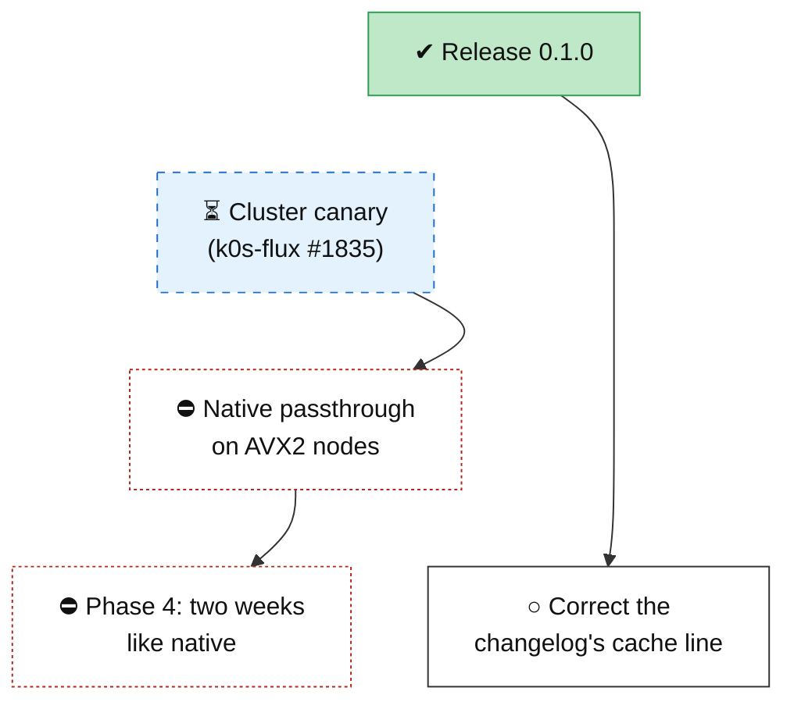

<!-- Generated by build.py from roadmap/nodes.yaml. Do not edit. -->

# prod - production

Scope: Phase 4: release, stability gate, production limits, the cluster canary.

[Back to the page](../../roadmap.md) · [legend](../../roadmap.md#legend)

<!-- BEGIN GENERATED: track-prod -->

<!-- END GENERATED: track-prod -->

## Node table

<!-- BEGIN GENERATED: table-prod -->
| id | title | kind | lane | state | outcome | start | end | depends_on | replaced_by | qualified_by | headline | evidence |
|---|---|---|---|---|---|---|---|---|---|---|---|---|
| `prod-order-of-work` | Order: JVM crashes first | decision | none | done | n/a | 2026-11-12 | 2026-11-12 | lab-phase0 |  |  |  | docs/plan.md; PR #36 |
| `prod-triage` | Won't fix and later lists | decision | none | done | n/a | 2026-11-18 | 2026-11-18 | fork-safe-spot |  |  |  | PR #65; branch plan-wontfix; docs/plan.md |
| `prod-limits` | Accept three production limits | decision | none | done | n/a | 2026-11-21 | 2026-11-21 | fork-vfork-kill, client-store-xl8 |  |  |  | docs/plan.md; CHANGELOG.md |
| `prod-stability-gate` | No release until crashes fixed | decision | none | done | n/a | 2026-11-21 | 2026-11-22 | fork-refuse-untranslatable |  |  |  | docs/plan.md; PR #78; PR #83 |
| `prod-release` | Release 0.1.0 | feature | none | done | successful | 2026-11-25 | 2026-11-25 | fork-selfmod-race, prod-limits |  |  |  | PR #83; commit dbbeadce; tag v0.1.0; CHANGELOG.md; docs/handover.md |
| `prod-canary` | Cluster canary (k0s-flux #1835) | feature | owner | in-progress | unrated | 2026-11-26 |  | cache-canary-call, runtime-installer |  |  |  | k0s-flux PR #1835; docs/handover.md |
| `prod-two-weeks` | Phase 4: two weeks like native | gate | agent | blocked | unrated |  |  | prod-canary, prod-passthrough |  |  |  |  |
| `prod-passthrough` | Native passthrough on AVX2 nodes | feature | owner | blocked | unrated |  |  | prod-canary |  |  |  | docs/adr/0004-opt-in-per-container.md; k0s-flux PR #1835 |
| `prod-changelog-cache` | Correct the changelog's cache line | fix | agent | next | unrated |  |  | prod-release |  |  |  | docs/handover.md; CHANGELOG.md |

### Details per node

| id | title | verdict | headline | in plain words | notes | confirmed | waiting on | queue order | order reason |
|---|---|---|---|---|---|---|---|---|---|
| `prod-order-of-work` | Order: JVM crashes first |  |  | The owner put JVM workloads in scope and ordered the work: the javac and Java crashes, then the ranked performance list, then the OCI wrapper. |  |  |  |  |  |
| `prod-triage` | Won't fix and later lists |  |  | The owner ruled three DynamoRIO-only problems out of scope (won't fix), and put fixing the cache reset on the later list. |  |  |  |  |  |
| `prod-limits` | Accept three production limits |  |  | The owner accepted three limits for production: a killed vfork child holding a lock ends the process (status 89), one random self-modifying sequence refuses, and one debug-only assert. |  |  |  |  |  |
| `prod-stability-gate` | No release until crashes fixed |  |  | The owner made the heap crash and the -sandbox_writable crash blockers: no release until both were fixed. |  |  |  |  |  |
| `prod-release` | Release 0.1.0 | 0.1.0 is released and its output verified byte-identical to native on Ivy Bridge, with the cache |  | The first release: a self-contained tarball whose output matched native byte for byte on Ivy Bridge, still about 20x slower than native at startup. |  |  |  |  |  |
| `prod-canary` | Cluster canary (k0s-flux #1835) |  |  | A long-lived translated duckdb on kube-worker-04 and a daily byte-for-byte comparison with native; built in k0s-flux #1835 (installer pinned), held unmerged until the owner decides about the cache. | Done when: the canary runs in the cluster through v3compat-runtime. |  | #1835 held until the owner's cache call |  |  |
| `prod-two-weeks` | Phase 4: two weeks like native |  |  | Phase 4's go/no-go: two weeks of the canary with no divergence from native. | Done when: two weeks of canary output compared with native, no divergence (plan, Phases). |  |  |  |  |
| `prod-passthrough` | Native passthrough on AVX2 nodes |  |  | Nodes with AVX2 run wrapped containers natively, keyed on a pinned node label; the installer for it is in #1835 but no node carries the label yet. | Done when: an AVX2 node with the label runs a wrapped pod natively. |  |  |  |  |
| `prod-changelog-cache` | Correct the changelog's cache line |  |  | CHANGELOG says the shipped launcher does not use the cache, but it reads V3COMPAT_CACHE; the line needs fixing whatever the canary decision. | Done when: CHANGELOG states what the launcher does with V3COMPAT_CACHE. |  |  |  |  |

### Folded items per node

- `prod-triage`: Won't fix and later lists
  - Static re-attach losing AVX-512 state left alone: v3compat does not use it (2026-11-09, session record)
- `prod-stability-gate`: No release until crashes fixed
  - Advisor review: not production ready, unexplained crashes and a vfork hang as blockers (2026-11-15, session record)
- `prod-release`: Release 0.1.0
  - Release workflow for the self-contained tarball, PR #76 (2026-11-22, commit 74d4e6a5, commit 731e963f, commit af5c5869)
<!-- END GENERATED: table-prod -->
