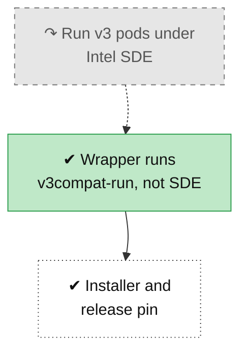

<!-- Generated by build.py from roadmap/nodes.yaml. Do not edit. -->

# runtime - runtime wrapper

Scope: lhns/v3compat-runtime: the OCI wrapper, SDE replaced by v3compat-run.

[Back to the page](../../roadmap.md) · [legend](../../roadmap.md#legend)

<!-- BEGIN GENERATED: track-runtime -->

<!-- END GENERATED: track-runtime -->

## Node table

<!-- BEGIN GENERATED: table-runtime -->
| id | title | kind | lane | state | outcome | start | end | depends_on | replaced_by | qualified_by | headline | evidence |
|---|---|---|---|---|---|---|---|---|---|---|---|---|
| `runtime-sde` | Run v3 pods under Intel SDE | feature | none | abandoned | superseded | 2026-11-03 | 2026-11-22 |  | runtime-v3compat-run |  |  | lhns/v3compat-runtime#1; lhns/v3compat-runtime#3 |
| `runtime-v3compat-run` | Wrapper runs v3compat-run, not SDE | feature | none | done | successful | 2026-11-21 | 2026-11-22 | launch-refused-exec, prod-order-of-work |  |  |  | lhns/v3compat-runtime#3; docs/plan.md; docs/adr/0004-opt-in-per-container.md |
| `runtime-installer` | Installer and release pin | feature | none | done | unrated | 2026-11-25 | 2026-11-26 | runtime-v3compat-run, prod-release |  |  |  | lhns/v3compat-runtime#4; lhns/v3compat-runtime#7; lhns/v3compat-runtime#8; lhns/v3compat-runtime#9; lhns/v3compat-runtime#13 |

### Details per node

| id | title | verdict | headline | in plain words | notes | confirmed | waiting on | queue order | order reason |
|---|---|---|---|---|---|---|---|---|---|
| `runtime-sde` | Run v3 pods under Intel SDE | Replaces Intel SDE with v3compat's static launcher (`v3compat-run`, lhns/v3compat ADR 0009). |  | The cluster first ran x86-64-v3 containers on the Ivy Bridge node under Intel SDE, about 300 times slower than native at startup. |  |  |  |  |  |
| `runtime-v3compat-run` | Wrapper runs v3compat-run, not SDE | In progress: the wrapper runs `v3compat-run` and fails closed |  | The OCI wrapper puts v3compat-run in front of the container's process and refuses to start the container if translation cannot be set up. |  |  |  |  |  |
| `runtime-installer` | Installer and release pin |  |  | A DaemonSet installer image puts the wrapper on nodes; the wrapper pins the 0.1.0 release and mounts the cache read-only. |  |  |  |  |  |

### Folded items per node

- `runtime-sde`: Run v3 pods under Intel SDE
  - SDE plan dropped from the open items: tried before and too slow (2026-11-17, session record)
- `runtime-v3compat-run`: Wrapper runs v3compat-run, not SDE
  - Plan: Ivy Bridge A/B results, approved targets, ADR 0004 amendments (passthrough, fail closed), PR #77 (2026-11-22, commit f6a68c80, commit 16dabbeb, commit d3655c47, commit 9387cb9f)
  - Owner: fail closed on nodes without x86-64-v3, amending ADR 0004 (2026-11-22, session record)
<!-- END GENERATED: table-runtime -->
